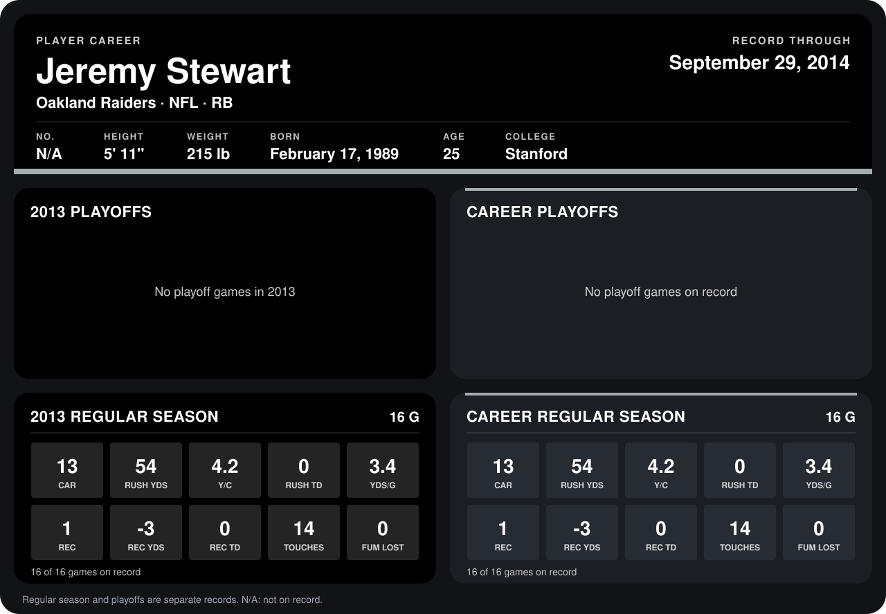

# Jeremy Stewart

## Career stats

### Regular season

| Season | Club | G | CAR | RUSH YDS | Y/C | RUSH TD | YDS/G | REC | REC YDS | REC TD | TOUCHES | FUM LOST |
|---|---|---:|---:|---:|---:|---:|---:|---:|---:|---:|---:|---:|
| 2013 | Oakland Raiders | 16 | 13 | 54 | 4.2 | 0 | 3.4 | 1 | -3 | 0 | 14 | 0 |
| **Career** |  | 16 | 13 | 54 | 4.2 | 0 | 3.4 | 1 | -3 | 0 | 14 | 0 |

### Playoffs

No playoff games on record.

## Awards

None on record.

Records through December 29, 2013. Identity: his listed 2013 season roster data (no 2014 Weeks 1-4 roster row). [All Oakland Raiders players](README.md).
