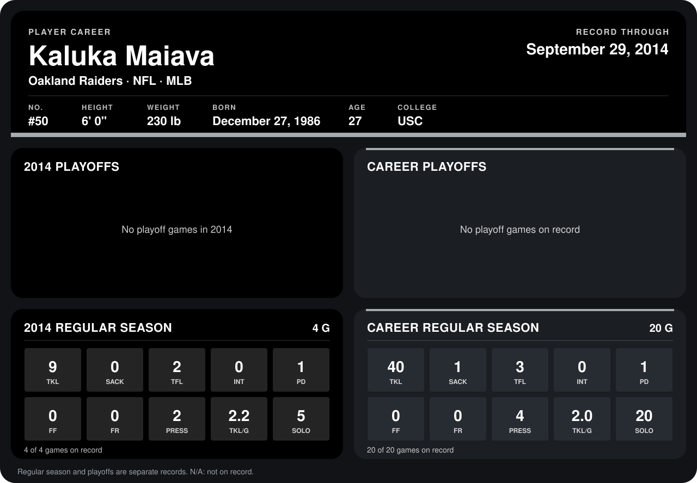

# Kaluka Maiava

## Career stats

### Regular season

| Season | Club | G | TKL | SACK | TFL | INT | PD | FF | FR | PRESS | TKL/G | SOLO |
|---|---|---:|---:|---:|---:|---:|---:|---:|---:|---:|---:|---:|
| 2013 | Oakland Raiders | 16 | 31 | 1 | 1 | 0 | 0 | 0 | 0 | 2 | 1.9 | 15 |
| 2014 | Oakland Raiders | 4 | 9 | 0 | 2 | 0 | 1 | 0 | 0 | 2 | 2.2 | 5 |
| **Career** |  | 20 | 40 | 1 | 3 | 0 | 1 | 0 | 0 | 4 | 2.0 | 20 |

### Playoffs

No playoff games on record.

## Awards

None on record.

Records through September 28, 2014. Identity: listed 2014 roster data, Weeks 1-4; number: 2014 Week 1 roster. [All Oakland Raiders players](README.md).
