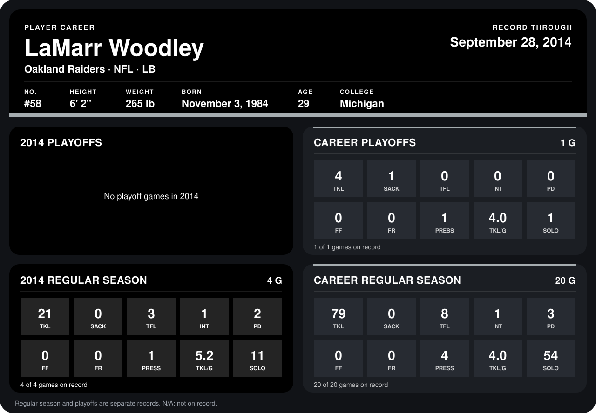

# LaMarr Woodley

## Career stats

### Regular season

| Season | Club | G | TKL | SACK | TFL | INT | PD | FF | FR | PRESS | TKL/G | SOLO |
|---|---|---:|---:|---:|---:|---:|---:|---:|---:|---:|---:|---:|
| 2013 | Pittsburgh Steelers | 16 | 58 | 0 | 5 | 0 | 1 | 0 | 0 | 3 | 3.6 | 43 |
| 2014 | Oakland Raiders | 4 | 21 | 0 | 3 | 1 | 2 | 0 | 0 | 1 | 5.2 | 11 |
| **Career** |  | 20 | 79 | 0 | 8 | 1 | 3 | 0 | 0 | 4 | 4.0 | 54 |

### Playoffs

| Season | Club | G | TKL | SACK | TFL | INT | PD | FF | FR | PRESS | TKL/G | SOLO |
|---|---|---:|---:|---:|---:|---:|---:|---:|---:|---:|---:|---:|
| 2013 | Pittsburgh Steelers | 1 | 4 | 1 | 0 | 0 | 0 | 0 | 0 | 1 | 4.0 | 1 |
| **Career** |  | 1 | 4 | 1 | 0 | 0 | 0 | 0 | 0 | 1 | 4.0 | 1 |

## Awards

None on record.

Records through September 29, 2014. Identity: listed 2014 roster data, Weeks 1-4; number: 2014 Week 1 roster. [All Oakland Raiders players](README.md).
