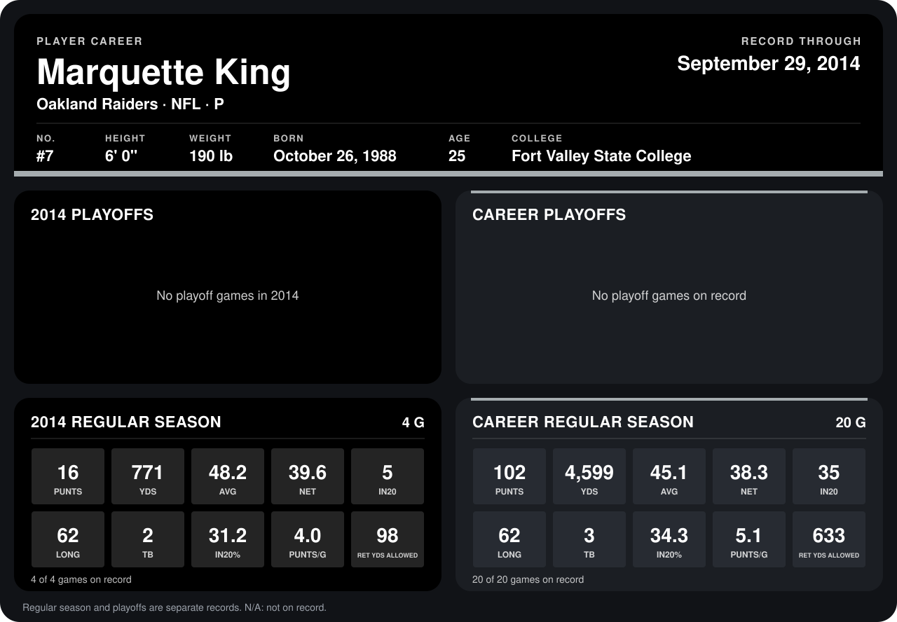

# Marquette King

## Career stats

### Regular season

| Season | Club | G | PUNTS | YDS | AVG | NET | IN20 | LONG | TB | IN20% | PUNTS/G | RET YDS ALLOWED |
|---|---|---:|---:|---:|---:|---:|---:|---:|---:|---:|---:|---:|
| 2013 | Oakland Raiders | 16 | 86 | 3,828 | 44.5 | 38.1 | 30 | 61 | 1 | 34.9 | 5.4 | 535 |
| 2014 | Oakland Raiders | 4 | 16 | 771 | 48.2 | 39.6 | 5 | 62 | 2 | 31.2 | 4.0 | 98 |
| **Career** |  | 20 | 102 | 4,599 | 45.1 | 38.3 | 35 | 62 | 3 | 34.3 | 5.1 | 633 |

### Playoffs

No playoff games on record.

## Awards

None on record.

Records through September 28, 2014. Identity: listed 2014 roster data, Weeks 1-4; number: 2014 Week 1 roster. [All Oakland Raiders players](README.md).
