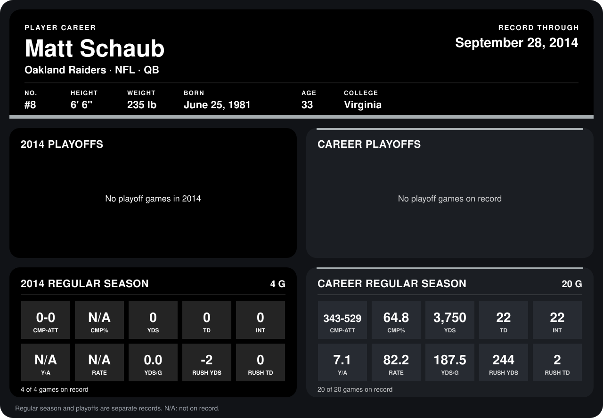

# Matt Schaub

## Career stats

### Regular season

| Season | Club | G | CMP-ATT | CMP% | YDS | TD | INT | Y/A | RATE | YDS/G | RUSH YDS | RUSH TD |
|---|---|---:|---:|---:|---:|---:|---:|---:|---:|---:|---:|---:|
| 2013 | Houston Texans | 16 | 343-529 | 64.8 | 3,750 | 22 | 22 | 7.1 | 82.2 | 234.4 | 246 | 2 |
| 2014 | Oakland Raiders | 4 | 0-0 | N/A | 0 | 0 | 0 | N/A | N/A | 0.0 | -2 | 0 |
| **Career** |  | 20 | 343-529 | 64.8 | 3,750 | 22 | 22 | 7.1 | 82.2 | 187.5 | 244 | 2 |

### Playoffs

No playoff games on record.

## Awards

None on record.

Records through September 28, 2014. Identity: listed 2014 roster data, Weeks 1-4; number: 2014 Week 1 roster. [All Oakland Raiders players](README.md).
