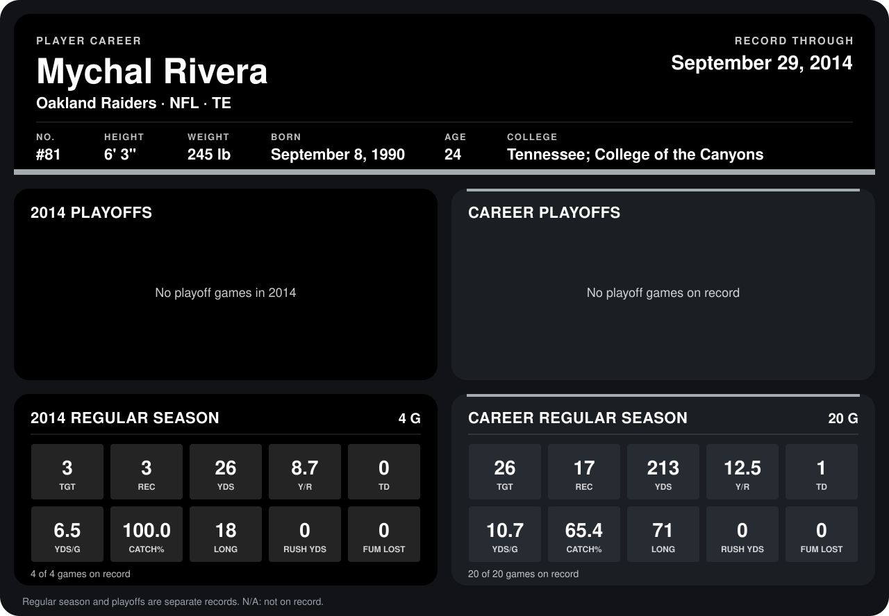

# Mychal Rivera

## Career stats

### Regular season

| Season | Club | G | TGT | REC | YDS | Y/R | TD | YDS/G | CATCH% | LONG | RUSH YDS | FUM LOST |
|---|---|---:|---:|---:|---:|---:|---:|---:|---:|---:|---:|---:|
| 2013 | Oakland Raiders | 16 | 23 | 14 | 187 | 13.4 | 1 | 11.7 | 60.9 | 71 | 0 | 0 |
| 2014 | Oakland Raiders | 4 | 3 | 3 | 26 | 8.7 | 0 | 6.5 | 100.0 | 18 | 0 | 0 |
| **Career** |  | 20 | 26 | 17 | 213 | 12.5 | 1 | 10.7 | 65.4 | 71 | 0 | 0 |

### Playoffs

No playoff games on record.

## Awards

None on record.

Records through September 28, 2014. Identity: listed 2014 roster data, Weeks 1-4; number: 2014 Week 1 roster. [All Oakland Raiders players](README.md).
