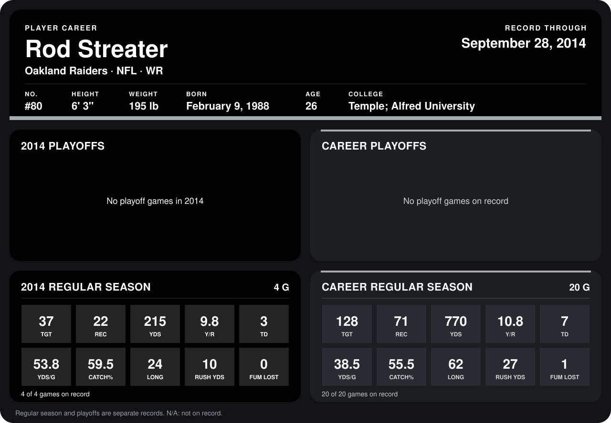

# Rod Streater

## Career stats

### Regular season

| Season | Team | Age | # | G | TGT | REC | YDS | Y/R | TD | YDS/G | CATCH% | LONG | RUSH YDS | FUM LOST |
|---|---|---:|---:|---:|---:|---:|---:|---:|---:|---:|---:|---:|---:|---:|
| 2013 | Oakland Raiders | 25 | 80 | 16 | 91 | 49 | 555 | 11.3 | 4 | 34.7 | 53.8 | 62 | 17 | 1 |
| 2014 | Oakland Raiders | 26 | 80 | 4 | 37 | 22 | 215 | 9.8 | 3 | 53.8 | 59.5 | 24 | 10 | 0 |
| **Career** |  |  |  | 20 | 128 | 71 | 770 | 10.8 | 7 | 38.5 | 55.5 | 62 | 27 | 1 |

### Playoffs

No playoff games on record.

## Awards

None on record.

Age is his age on the league's opening game of each season; # is the number listed for him that season with that team (2014: the card's rule; 2013: the 2013 season roster), N/A where no listing applies.

Records through September 28, 2014. Identity: listed 2014 roster data, Weeks 1-4; number: 2014 Week 1 roster. [All Oakland Raiders players](README.md).
