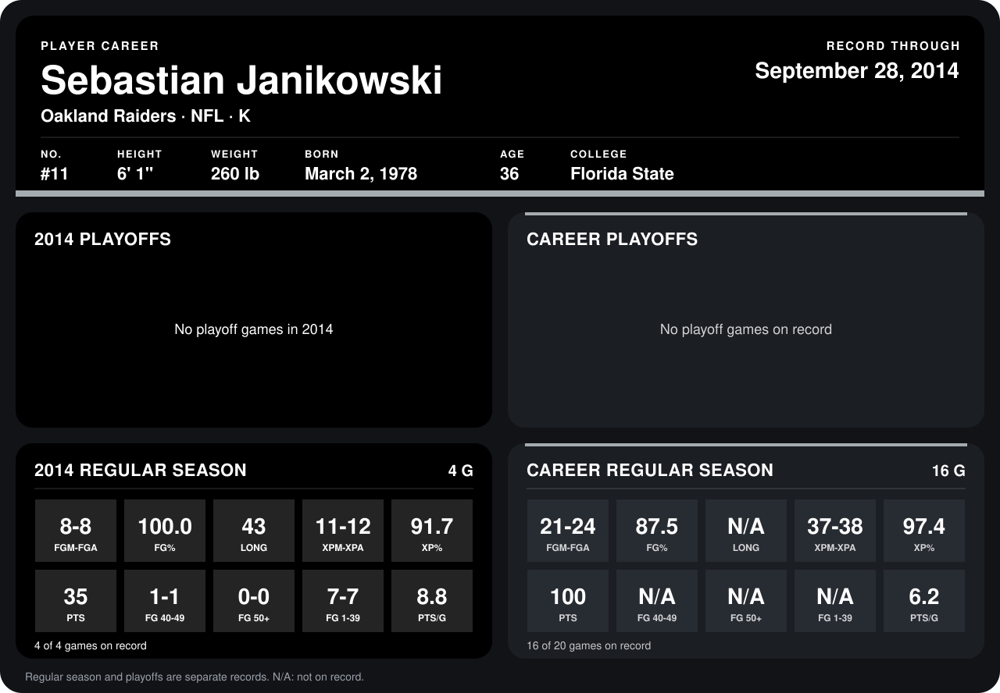

# Sebastian Janikowski

## Career stats

### Regular season

| Season | Team | Age | # | G | FGM-FGA | FG% | LONG | XPM-XPA | XP% | PTS | FG 40-49 | FG 50+ | FG 1-39 | PTS/G |
|---|---|---:|---:|---:|---:|---:|---:|---:|---:|---:|---:|---:|---:|---:|
| 2013 | Oakland Raiders | 35 | 11 | 12 | 13-16 | 81.2 | N/A | 26-26 | 100.0 | 65 | N/A | N/A | N/A | 5.4 |
| 2014 | Oakland Raiders | 36 | 11 | 4 | 8-8 | 100.0 | 43 | 11-12 | 91.7 | 35 | 1-1 | 0-0 | 7-7 | 8.8 |
| **Career** |  |  |  | 16 | 21-24 | 87.5 | N/A | 37-38 | 97.4 | 100 | N/A | N/A | N/A | 6.2 |

### Playoffs

No playoff games on record.

## Awards

- AFC Special Teams Player of the Week (2014, Week 2)

Age is his age on the league's opening game of each season; # is the number listed for him that season with that team (2014: the card's rule; 2013: the 2013 season roster), N/A where no listing applies.

Records through September 28, 2014. Identity: listed 2014 roster data, Weeks 1-4; number: 2014 Week 1 roster. [All Oakland Raiders players](README.md).
