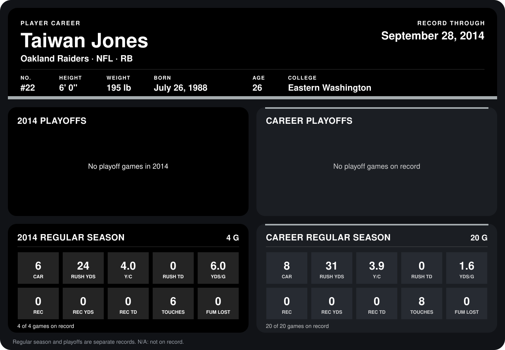

# Taiwan Jones

## Career stats

### Regular season

| Season | Club | G | CAR | RUSH YDS | Y/C | RUSH TD | YDS/G | REC | REC YDS | REC TD | TOUCHES | FUM LOST |
|---|---|---:|---:|---:|---:|---:|---:|---:|---:|---:|---:|---:|
| 2013 | Oakland Raiders | 16 | 2 | 7 | 3.5 | 0 | 0.4 | 0 | 0 | 0 | 2 | 0 |
| 2014 | Oakland Raiders | 4 | 6 | 24 | 4.0 | 0 | 6.0 | 0 | 0 | 0 | 6 | 0 |
| **Career** |  | 20 | 8 | 31 | 3.9 | 0 | 1.6 | 0 | 0 | 0 | 8 | 0 |

### Playoffs

No playoff games on record.

## Awards

None on record.

Records through September 28, 2014. Identity: listed 2014 roster data, Weeks 1-4; number: 2014 Week 1 roster. [All Oakland Raiders players](README.md).
