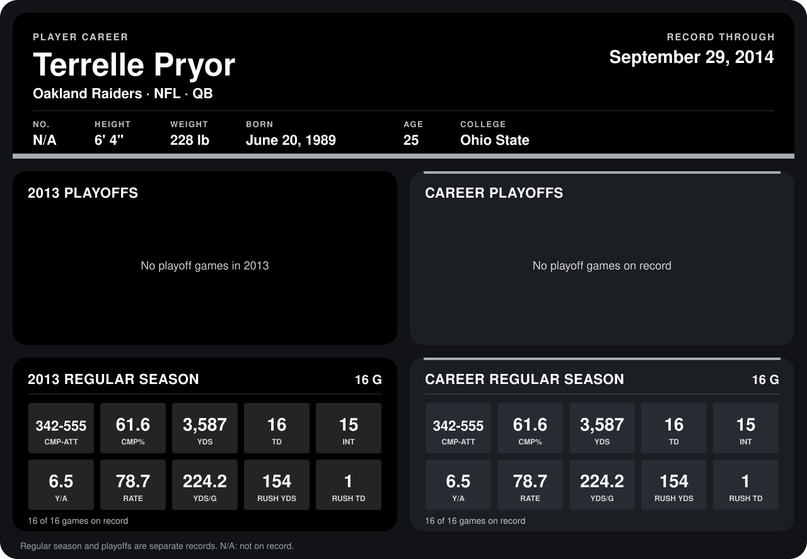

# Terrelle Pryor

## Career stats

### Regular season

| Season | Club | G | CMP-ATT | CMP% | YDS | TD | INT | Y/A | RATE | YDS/G | RUSH YDS | RUSH TD |
|---|---|---:|---:|---:|---:|---:|---:|---:|---:|---:|---:|---:|
| 2013 | Oakland Raiders | 16 | 342-555 | 61.6 | 3,587 | 16 | 15 | 6.5 | 78.7 | 224.2 | 154 | 1 |
| **Career** |  | 16 | 342-555 | 61.6 | 3,587 | 16 | 15 | 6.5 | 78.7 | 224.2 | 154 | 1 |

### Playoffs

No playoff games on record.

## Awards

None on record.

Records through September 29, 2014. Identity: the public player file's latest listing (no 2014 Weeks 1-4 roster row). [All Oakland Raiders players](README.md).
