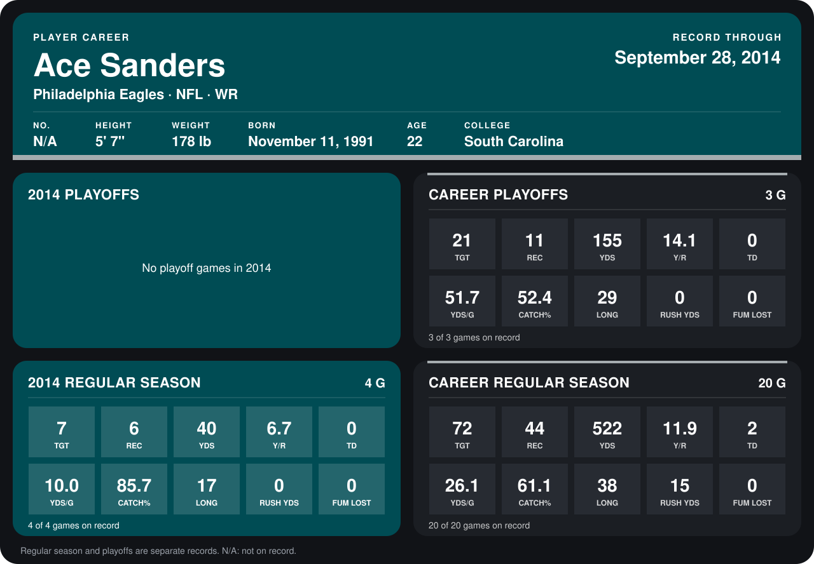

# Ace Sanders

## Career stats

### Regular season

| Season | Club | G | TGT | REC | YDS | Y/R | TD | YDS/G | CATCH% | LONG | RUSH YDS | FUM LOST |
|---|---|---:|---:|---:|---:|---:|---:|---:|---:|---:|---:|---:|
| 2013 | Philadelphia Eagles | 16 | 65 | 38 | 482 | 12.7 | 2 | 30.1 | 58.5 | 38 | 15 | 0 |
| 2014 | Philadelphia Eagles | 4 | 7 | 6 | 40 | 6.7 | 0 | 10.0 | 85.7 | 17 | 0 | 0 |
| **Career** |  | 20 | 72 | 44 | 522 | 11.9 | 2 | 26.1 | 61.1 | 38 | 15 | 0 |

### Playoffs

| Season | Club | G | TGT | REC | YDS | Y/R | TD | YDS/G | CATCH% | LONG | RUSH YDS | FUM LOST |
|---|---|---:|---:|---:|---:|---:|---:|---:|---:|---:|---:|---:|
| 2013 | Philadelphia Eagles | 3 | 21 | 11 | 155 | 14.1 | 0 | 51.7 | 52.4 | 29 | 0 | 0 |
| **Career** |  | 3 | 21 | 11 | 155 | 14.1 | 0 | 51.7 | 52.4 | 29 | 0 | 0 |

## Awards

None on record.

Records through September 29, 2014. Identity: the public player file's latest listing (no 2014 Weeks 1-4 roster row). [All Philadelphia Eagles players](README.md).
