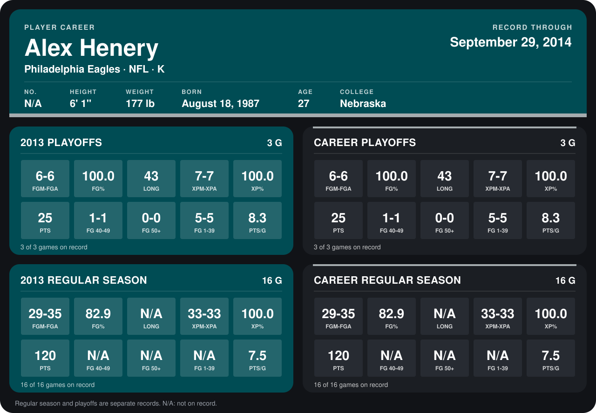

# Alex Henery

## Career stats

### Regular season

| Season | Team | Age | # | G | FGM-FGA | FG% | LONG | XPM-XPA | XP% | PTS | FG 40-49 | FG 50+ | FG 1-39 | PTS/G |
|---|---|---:|---:|---:|---:|---:|---:|---:|---:|---:|---:|---:|---:|---:|
| 2013 | Philadelphia Eagles | 26 | 6 | 16 | 29-35 | 82.9 | N/A | 33-33 | 100.0 | 120 | N/A | N/A | N/A | 7.5 |
| **Career** |  |  |  | 16 | 29-35 | 82.9 | N/A | 33-33 | 100.0 | 120 | N/A | N/A | N/A | 7.5 |

### Playoffs

| Season | Team | Age | # | G | FGM-FGA | FG% | LONG | XPM-XPA | XP% | PTS | FG 40-49 | FG 50+ | FG 1-39 | PTS/G |
|---|---|---:|---:|---:|---:|---:|---:|---:|---:|---:|---:|---:|---:|---:|
| 2013 | Philadelphia Eagles | 26 | 6 | 3 | 6-6 | 100.0 | 43 | 7-7 | 100.0 | 25 | 1-1 | 0-0 | 5-5 | 8.3 |
| **Career** |  |  |  | 3 | 6-6 | 100.0 | 43 | 7-7 | 100.0 | 25 | 1-1 | 0-0 | 5-5 | 8.3 |

## Awards

None on record.

Age is his age on the league's opening game of each season; # is the number listed for him that season with that team (2014: the card's rule; 2013: the 2013 season roster), N/A where no listing applies.

Records through January 19, 2014. Identity: listed 2014 roster data, Weeks 1-4. [All Philadelphia Eagles players](README.md).
