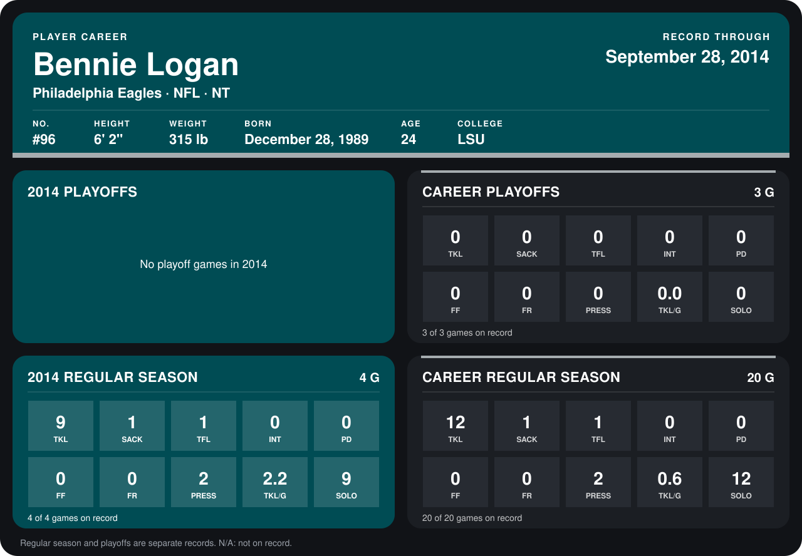

# Bennie Logan

## Career stats

### Regular season

| Season | Club | G | TKL | SACK | TFL | INT | PD | FF | FR | PRESS | TKL/G | SOLO |
|---|---|---:|---:|---:|---:|---:|---:|---:|---:|---:|---:|---:|
| 2013 | Philadelphia Eagles | 16 | 3 | 0 | 0 | 0 | 0 | 0 | 0 | 0 | 0.2 | 3 |
| 2014 | Philadelphia Eagles | 4 | 9 | 1 | 1 | 0 | 0 | 0 | 0 | 2 | 2.2 | 9 |
| **Career** |  | 20 | 12 | 1 | 1 | 0 | 0 | 0 | 0 | 2 | 0.6 | 12 |

### Playoffs

| Season | Club | G | TKL | SACK | TFL | INT | PD | FF | FR | PRESS | TKL/G | SOLO |
|---|---|---:|---:|---:|---:|---:|---:|---:|---:|---:|---:|---:|
| 2013 | Philadelphia Eagles | 3 | 0 | 0 | 0 | 0 | 0 | 0 | 0 | 0 | 0.0 | 0 |
| **Career** |  | 3 | 0 | 0 | 0 | 0 | 0 | 0 | 0 | 0 | 0.0 | 0 |

## Awards

None on record.

Records through September 29, 2014. Identity: listed 2014 roster data, Weeks 1-4; number: 2014 Week 1 roster. [All Philadelphia Eagles players](README.md).
