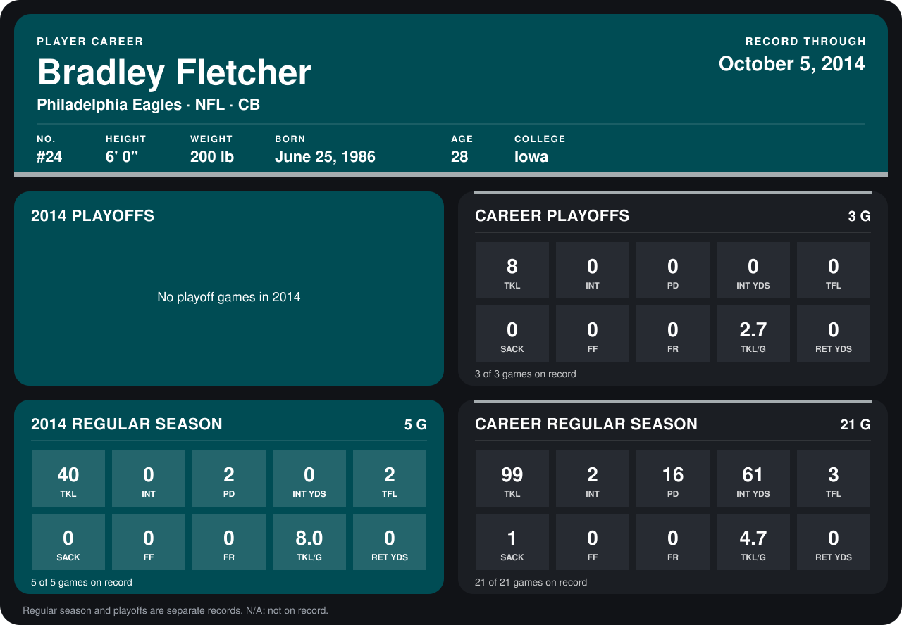

# Bradley Fletcher

## Career stats

### Regular season

| Season | Club | G | TKL | INT | PD | INT YDS | TFL | SACK | FF | FR | TKL/G | RET YDS |
|---|---|---:|---:|---:|---:|---:|---:|---:|---:|---:|---:|---:|
| 2013 | Philadelphia Eagles | 16 | 59 | 2 | 14 | 61 | 1 | 1 | 0 | 0 | 3.7 | 0 |
| 2014 | Philadelphia Eagles | 4 | 31 | 0 | 2 | 0 | 2 | 0 | 0 | 0 | 7.8 | 0 |
| **Career** |  | 20 | 90 | 2 | 16 | 61 | 3 | 1 | 0 | 0 | 4.5 | 0 |

### Playoffs

| Season | Club | G | TKL | INT | PD | INT YDS | TFL | SACK | FF | FR | TKL/G | RET YDS |
|---|---|---:|---:|---:|---:|---:|---:|---:|---:|---:|---:|---:|
| 2013 | Philadelphia Eagles | 3 | 8 | 0 | 0 | 0 | 0 | 0 | 0 | 0 | 2.7 | 0 |
| **Career** |  | 3 | 8 | 0 | 0 | 0 | 0 | 0 | 0 | 0 | 2.7 | 0 |

## Awards

None on record.

Records through September 28, 2014. Identity: listed 2014 roster data, Weeks 1-4; number: 2014 Week 1 roster. [All Philadelphia Eagles players](README.md).
