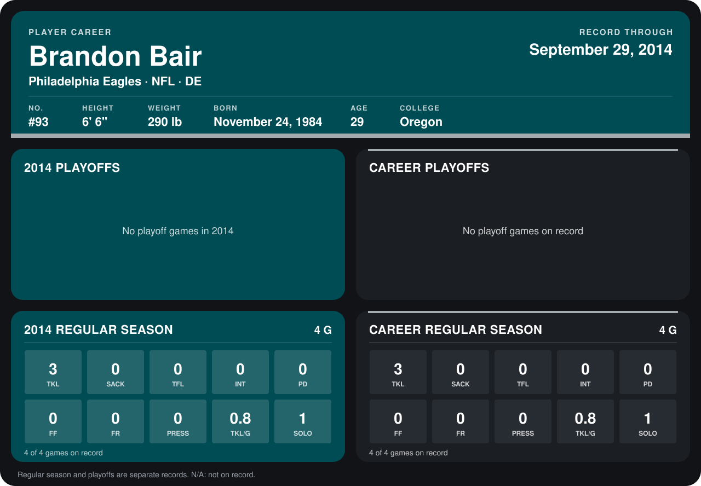

# Brandon Bair

## Career stats

### Regular season

| Season | Club | G | TKL | SACK | TFL | INT | PD | FF | FR | PRESS | TKL/G | SOLO |
|---|---|---:|---:|---:|---:|---:|---:|---:|---:|---:|---:|---:|
| 2014 | Philadelphia Eagles | 4 | 3 | 0 | 0 | 0 | 0 | 0 | 0 | 0 | 0.8 | 1 |
| **Career** |  | 4 | 3 | 0 | 0 | 0 | 0 | 0 | 0 | 0 | 0.8 | 1 |

### Playoffs

No playoff games on record.

## Awards

None on record.

Records through September 29, 2014. Identity: listed 2014 roster data, Weeks 1-4; number: 2014 Week 1 roster. [All Philadelphia Eagles players](README.md).
