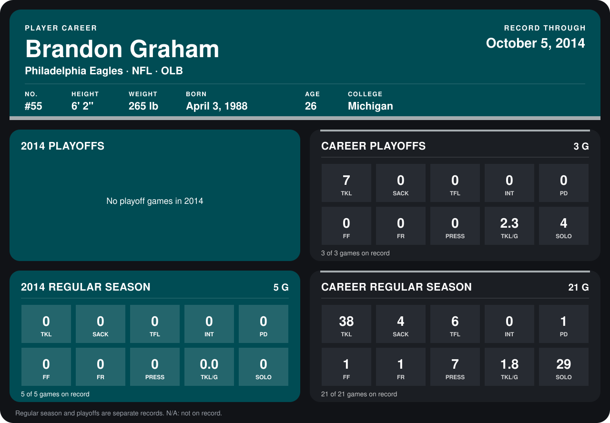

# Brandon Graham

## Career stats

### Regular season

| Season | Team | Age | # | G | TKL | SACK | TFL | INT | PD | FF | FR | PRESS | TKL/G | SOLO |
|---|---|---:|---:|---:|---:|---:|---:|---:|---:|---:|---:|---:|---:|---:|
| 2013 | Philadelphia Eagles | 25 | 55 | 16 | 38 | 4 | 6 | 0 | 1 | 1 | 1 | 7 | 2.4 | 29 |
| 2014 | Philadelphia Eagles | 26 | 55 | 5 | 0 | 0 | 0 | 0 | 0 | 0 | 0 | 0 | 0.0 | 0 |
| **Career** |  |  |  | 21 | 38 | 4 | 6 | 0 | 1 | 1 | 1 | 7 | 1.8 | 29 |

### Playoffs

| Season | Team | Age | # | G | TKL | SACK | TFL | INT | PD | FF | FR | PRESS | TKL/G | SOLO |
|---|---|---:|---:|---:|---:|---:|---:|---:|---:|---:|---:|---:|---:|---:|
| 2013 | Philadelphia Eagles | 25 | 55 | 3 | 7 | 0 | 0 | 0 | 0 | 0 | 0 | 0 | 2.3 | 4 |
| **Career** |  |  |  | 3 | 7 | 0 | 0 | 0 | 0 | 0 | 0 | 0 | 2.3 | 4 |

## Awards

None on record.

Age is his age on the league's opening game of each season; # is the number listed for him that season with that team (2014: the card's rule; 2013: the 2013 season roster), N/A where no listing applies.

Records through October 5, 2014. Identity: listed 2014 roster data, Weeks 1-4; number: 2014 Week 1 roster. [All Philadelphia Eagles players](README.md).
