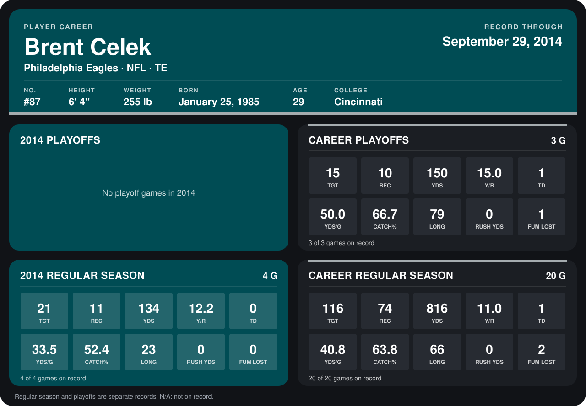

# Brent Celek

## Career stats

### Regular season

| Season | Club | G | TGT | REC | YDS | Y/R | TD | YDS/G | CATCH% | LONG | RUSH YDS | FUM LOST |
|---|---|---:|---:|---:|---:|---:|---:|---:|---:|---:|---:|---:|
| 2013 | Philadelphia Eagles | 16 | 95 | 63 | 682 | 10.8 | 1 | 42.6 | 66.3 | 66 | 0 | 2 |
| 2014 | Philadelphia Eagles | 4 | 21 | 11 | 134 | 12.2 | 0 | 33.5 | 52.4 | 23 | 0 | 0 |
| **Career** |  | 20 | 116 | 74 | 816 | 11.0 | 1 | 40.8 | 63.8 | 66 | 0 | 2 |

### Playoffs

| Season | Club | G | TGT | REC | YDS | Y/R | TD | YDS/G | CATCH% | LONG | RUSH YDS | FUM LOST |
|---|---|---:|---:|---:|---:|---:|---:|---:|---:|---:|---:|---:|
| 2013 | Philadelphia Eagles | 3 | 15 | 10 | 150 | 15.0 | 1 | 50.0 | 66.7 | 79 | 0 | 1 |
| **Career** |  | 3 | 15 | 10 | 150 | 15.0 | 1 | 50.0 | 66.7 | 79 | 0 | 1 |

## Awards

None on record.

Records through September 28, 2014. Identity: listed 2014 roster data, Weeks 1-4; number: 2014 Week 1 roster. [All Philadelphia Eagles players](README.md).
