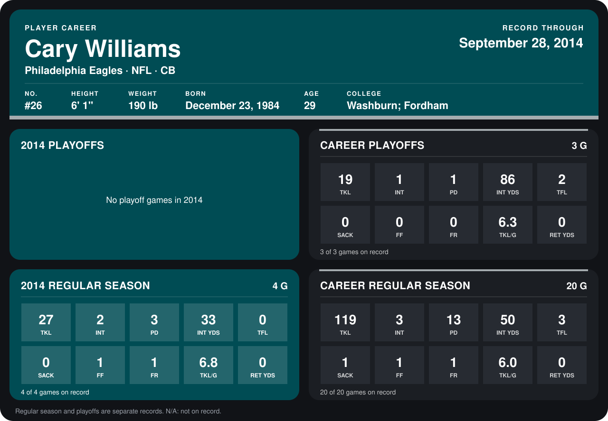

# Cary Williams

## Career stats

### Regular season

| Season | Team | Age | # | G | TKL | INT | PD | INT YDS | TFL | SACK | FF | FR | TKL/G | RET YDS |
|---|---|---:|---:|---:|---:|---:|---:|---:|---:|---:|---:|---:|---:|---:|
| 2013 | Philadelphia Eagles | 28 | 26 | 16 | 92 | 1 | 10 | 17 | 3 | 1 | 0 | 0 | 5.8 | 0 |
| 2014 | Philadelphia Eagles | 29 | 26 | 5 | 30 | 2 | 4 | 33 | 1 | 0 | 1 | 1 | 6.0 | 0 |
| **Career** |  |  |  | 21 | 122 | 3 | 14 | 50 | 4 | 1 | 1 | 1 | 5.8 | 0 |

### Playoffs

| Season | Team | Age | # | G | TKL | INT | PD | INT YDS | TFL | SACK | FF | FR | TKL/G | RET YDS |
|---|---|---:|---:|---:|---:|---:|---:|---:|---:|---:|---:|---:|---:|---:|
| 2013 | Philadelphia Eagles | 28 | 26 | 3 | 19 | 1 | 1 | 86 | 2 | 0 | 0 | 0 | 6.3 | 0 |
| **Career** |  |  |  | 3 | 19 | 1 | 1 | 86 | 2 | 0 | 0 | 0 | 6.3 | 0 |

## Awards

None on record.

Age is his age on the league's opening game of each season; # is the number listed for him that season with that team (2014: the card's rule; 2013: the 2013 season roster), N/A where no listing applies.

Records through October 5, 2014. Identity: listed 2014 roster data, Weeks 1-4; number: 2014 Week 1 roster. [All Philadelphia Eagles players](README.md).
