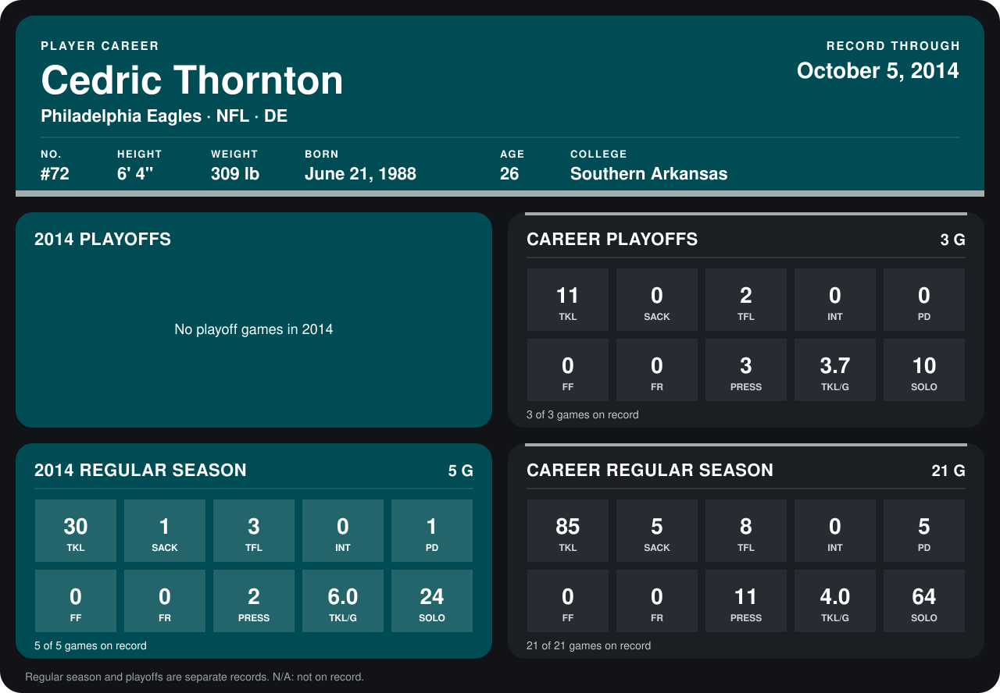

# Cedric Thornton

## Career stats

### Regular season

| Season | Club | G | TKL | SACK | TFL | INT | PD | FF | FR | PRESS | TKL/G | SOLO |
|---|---|---:|---:|---:|---:|---:|---:|---:|---:|---:|---:|---:|
| 2013 | Philadelphia Eagles | 16 | 55 | 4 | 5 | 0 | 4 | 0 | 0 | 9 | 3.4 | 40 |
| 2014 | Philadelphia Eagles | 4 | 26 | 1 | 3 | 0 | 0 | 0 | 0 | 2 | 6.5 | 20 |
| **Career** |  | 20 | 81 | 5 | 8 | 0 | 4 | 0 | 0 | 11 | 4.0 | 60 |

### Playoffs

| Season | Club | G | TKL | SACK | TFL | INT | PD | FF | FR | PRESS | TKL/G | SOLO |
|---|---|---:|---:|---:|---:|---:|---:|---:|---:|---:|---:|---:|
| 2013 | Philadelphia Eagles | 3 | 11 | 0 | 2 | 0 | 0 | 0 | 0 | 3 | 3.7 | 10 |
| **Career** |  | 3 | 11 | 0 | 2 | 0 | 0 | 0 | 0 | 3 | 3.7 | 10 |

## Awards

None on record.

Records through September 29, 2014. Identity: listed 2014 roster data, Weeks 1-4; number: 2014 Week 1 roster. [All Philadelphia Eagles players](README.md).
