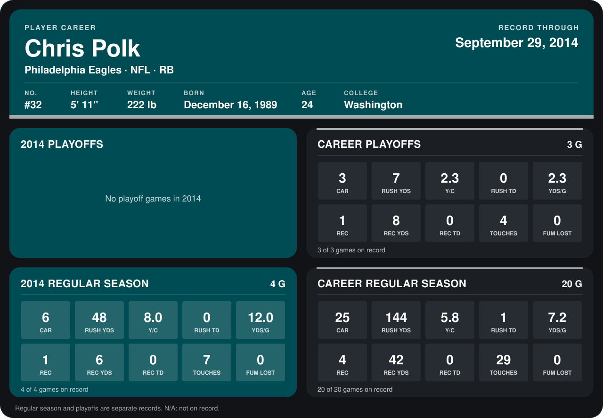

# Chris Polk

## Career stats

### Regular season

| Season | Team | Age | # | G | CAR | RUSH YDS | Y/C | RUSH TD | YDS/G | REC | REC YDS | REC TD | TOUCHES | FUM LOST |
|---|---|---:|---:|---:|---:|---:|---:|---:|---:|---:|---:|---:|---:|---:|
| 2013 | Philadelphia Eagles | 23 | 32 | 16 | 19 | 96 | 5.1 | 1 | 6.0 | 3 | 36 | 0 | 22 | 0 |
| 2014 | Philadelphia Eagles | 24 | 32 | 4 | 6 | 48 | 8.0 | 0 | 12.0 | 1 | 6 | 0 | 7 | 0 |
| **Career** |  |  |  | 20 | 25 | 144 | 5.8 | 1 | 7.2 | 4 | 42 | 0 | 29 | 0 |

### Playoffs

| Season | Team | Age | # | G | CAR | RUSH YDS | Y/C | RUSH TD | YDS/G | REC | REC YDS | REC TD | TOUCHES | FUM LOST |
|---|---|---:|---:|---:|---:|---:|---:|---:|---:|---:|---:|---:|---:|---:|
| 2013 | Philadelphia Eagles | 23 | 32 | 3 | 3 | 7 | 2.3 | 0 | 2.3 | 1 | 8 | 0 | 4 | 0 |
| **Career** |  |  |  | 3 | 3 | 7 | 2.3 | 0 | 2.3 | 1 | 8 | 0 | 4 | 0 |

## Awards

None on record.

Age is his age on the league's opening game of each season; # is the number listed for him that season with that team (2014: the card's rule; 2013: the 2013 season roster), N/A where no listing applies.

Records through September 28, 2014. Identity: listed 2014 roster data, Weeks 1-4; number: 2014 Week 1 roster. [All Philadelphia Eagles players](README.md).
