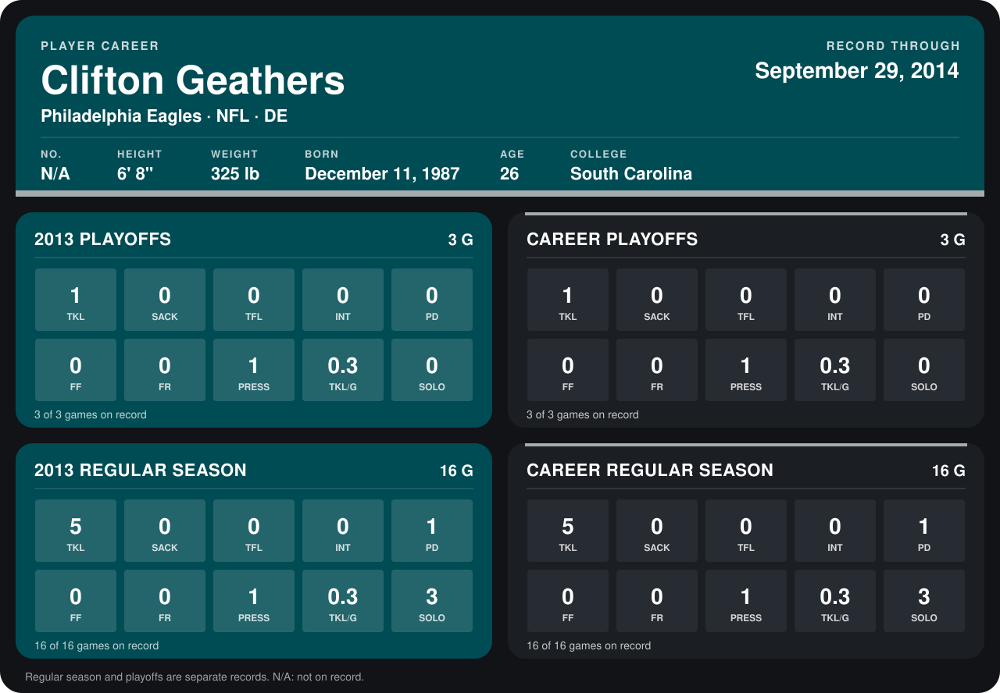

# Clifton Geathers

## Career stats

### Regular season

| Season | Club | G | TKL | SACK | TFL | INT | PD | FF | FR | PRESS | TKL/G | SOLO |
|---|---|---:|---:|---:|---:|---:|---:|---:|---:|---:|---:|---:|
| 2013 | Philadelphia Eagles | 16 | 5 | 0 | 0 | 0 | 1 | 0 | 0 | 1 | 0.3 | 3 |
| **Career** |  | 16 | 5 | 0 | 0 | 0 | 1 | 0 | 0 | 1 | 0.3 | 3 |

### Playoffs

| Season | Club | G | TKL | SACK | TFL | INT | PD | FF | FR | PRESS | TKL/G | SOLO |
|---|---|---:|---:|---:|---:|---:|---:|---:|---:|---:|---:|---:|
| 2013 | Philadelphia Eagles | 3 | 1 | 0 | 0 | 0 | 0 | 0 | 0 | 1 | 0.3 | 0 |
| **Career** |  | 3 | 1 | 0 | 0 | 0 | 0 | 0 | 0 | 1 | 0.3 | 0 |

## Awards

None on record.

Records through January 19, 2014. Identity: listed 2014 roster data, Weeks 1-4. [All Philadelphia Eagles players](README.md).
