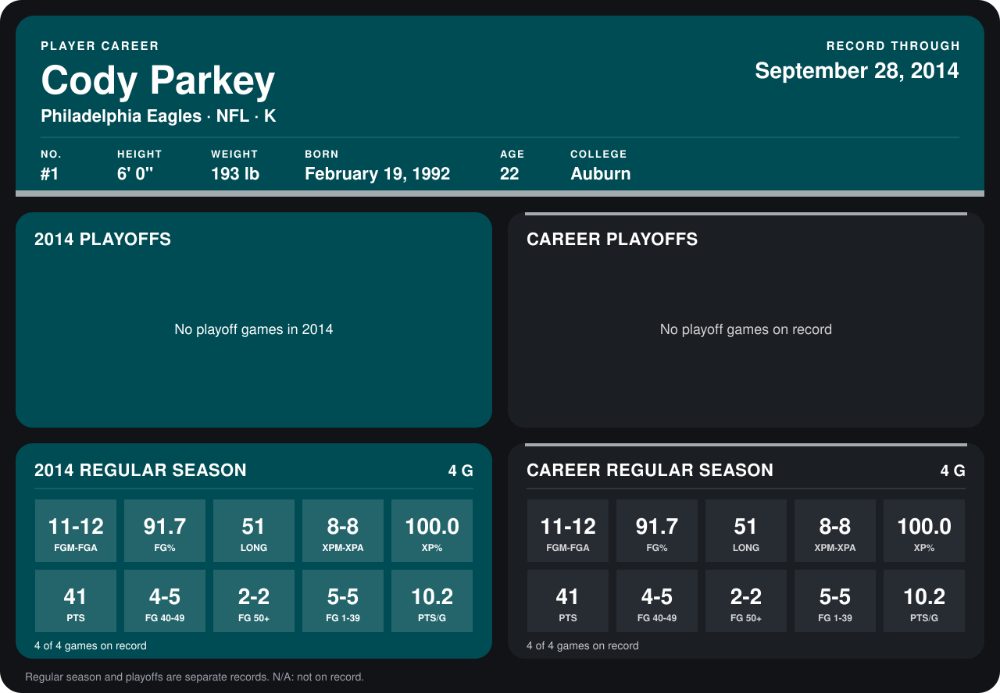

# Cody Parkey

## Career stats

### Regular season

| Season | Club | G | FGM-FGA | FG% | LONG | XPM-XPA | XP% | PTS | FG 40-49 | FG 50+ | FG 1-39 | PTS/G |
|---|---|---:|---:|---:|---:|---:|---:|---:|---:|---:|---:|---:|
| 2014 | Philadelphia Eagles | 4 | 11-12 | 91.7 | 51 | 8-8 | 100.0 | 41 | 4-5 | 2-2 | 5-5 | 10.2 |
| **Career** |  | 4 | 11-12 | 91.7 | 51 | 8-8 | 100.0 | 41 | 4-5 | 2-2 | 5-5 | 10.2 |

### Playoffs

No playoff games on record.

## Awards

None on record.

Records through September 28, 2014. Identity: listed 2014 roster data, Weeks 1-4; number: 2014 Week 1 roster. [All Philadelphia Eagles players](README.md).
