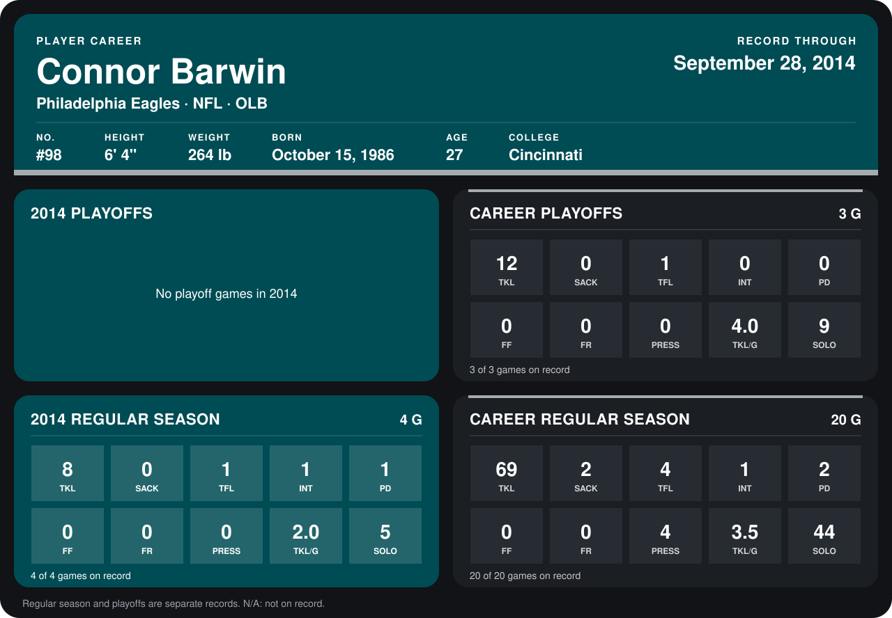

# Connor Barwin

## Career stats

### Regular season

| Season | Club | G | TKL | SACK | TFL | INT | PD | FF | FR | PRESS | TKL/G | SOLO |
|---|---|---:|---:|---:|---:|---:|---:|---:|---:|---:|---:|---:|
| 2013 | Philadelphia Eagles | 16 | 61 | 2 | 3 | 0 | 1 | 0 | 0 | 4 | 3.8 | 39 |
| 2014 | Philadelphia Eagles | 5 | 11 | 0 | 2 | 1 | 1 | 0 | 0 | 0 | 2.2 | 8 |
| **Career** |  | 21 | 72 | 2 | 5 | 1 | 2 | 0 | 0 | 4 | 3.4 | 47 |

### Playoffs

| Season | Club | G | TKL | SACK | TFL | INT | PD | FF | FR | PRESS | TKL/G | SOLO |
|---|---|---:|---:|---:|---:|---:|---:|---:|---:|---:|---:|---:|
| 2013 | Philadelphia Eagles | 3 | 12 | 0 | 1 | 0 | 0 | 0 | 0 | 0 | 4.0 | 9 |
| **Career** |  | 3 | 12 | 0 | 1 | 0 | 0 | 0 | 0 | 0 | 4.0 | 9 |

## Awards

None on record.

Records through October 5, 2014. Identity: listed 2014 roster data, Weeks 1-4; number: 2014 Week 1 roster. [All Philadelphia Eagles players](README.md).
