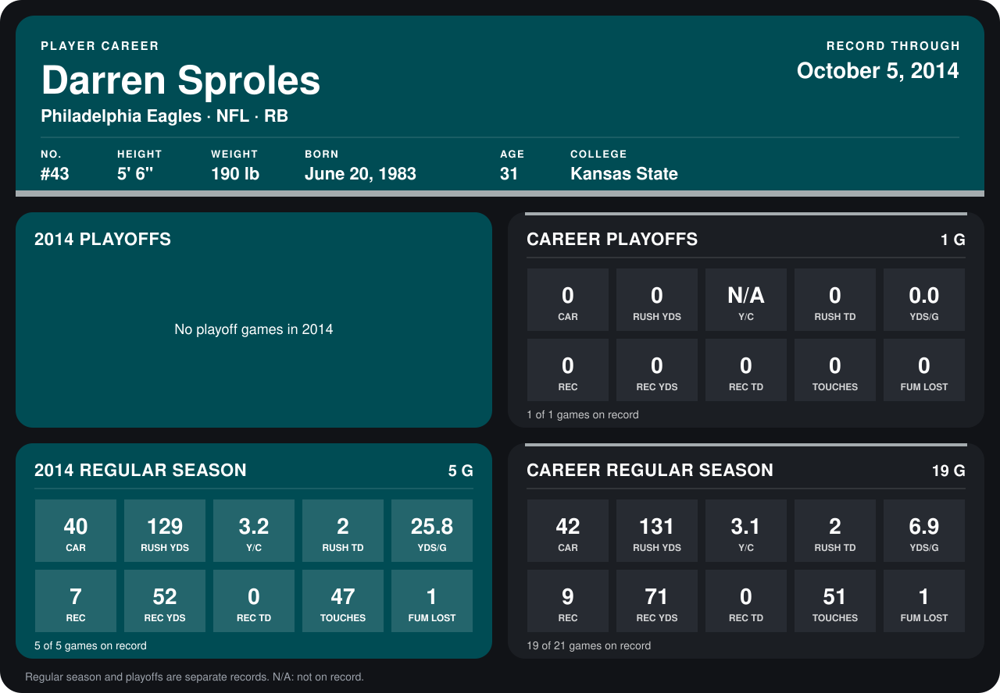

# Darren Sproles

## Career stats

### Regular season

| Season | Club | G | CAR | RUSH YDS | Y/C | RUSH TD | YDS/G | REC | REC YDS | REC TD | TOUCHES | FUM LOST |
|---|---|---:|---:|---:|---:|---:|---:|---:|---:|---:|---:|---:|
| 2013 | New Orleans Saints | 14 | 2 | 2 | 1.0 | 0 | 0.1 | 2 | 19 | 0 | 4 | 0 |
| 2014 | Philadelphia Eagles | 5 | 40 | 129 | 3.2 | 2 | 25.8 | 7 | 52 | 0 | 47 | 1 |
| **Career** |  | 19 | 42 | 131 | 3.1 | 2 | 6.9 | 9 | 71 | 0 | 51 | 1 |

### Playoffs

| Season | Club | G | CAR | RUSH YDS | Y/C | RUSH TD | YDS/G | REC | REC YDS | REC TD | TOUCHES | FUM LOST |
|---|---|---:|---:|---:|---:|---:|---:|---:|---:|---:|---:|---:|
| 2013 | New Orleans Saints | 1 | 0 | 0 | N/A | 0 | 0.0 | 0 | 0 | 0 | 0 | 0 |
| **Career** |  | 1 | 0 | 0 | N/A | 0 | 0.0 | 0 | 0 | 0 | 0 | 0 |

## Awards

- NFC Special Teams Player of the Week (2013, Week 16)

Records through October 5, 2014. Identity: listed 2014 roster data, Weeks 1-4; number: 2014 Week 1 roster. [All Philadelphia Eagles players](README.md).
