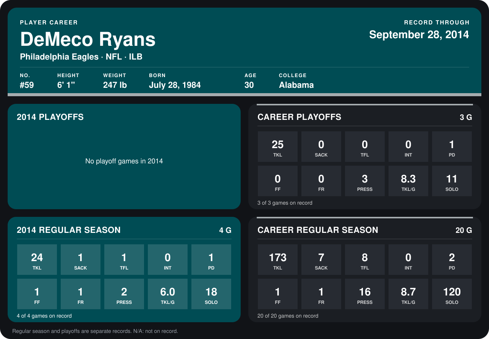

# DeMeco Ryans

## Career stats

### Regular season

| Season | Club | G | TKL | SACK | TFL | INT | PD | FF | FR | PRESS | TKL/G | SOLO |
|---|---|---:|---:|---:|---:|---:|---:|---:|---:|---:|---:|---:|
| 2013 | Philadelphia Eagles | 16 | 149 | 6 | 7 | 0 | 1 | 0 | 0 | 14 | 9.3 | 102 |
| 2014 | Philadelphia Eagles | 5 | 38 | 2 | 3 | 0 | 1 | 1 | 1 | 3 | 7.6 | 29 |
| **Career** |  | 21 | 187 | 8 | 10 | 0 | 2 | 1 | 1 | 17 | 8.9 | 131 |

### Playoffs

| Season | Club | G | TKL | SACK | TFL | INT | PD | FF | FR | PRESS | TKL/G | SOLO |
|---|---|---:|---:|---:|---:|---:|---:|---:|---:|---:|---:|---:|
| 2013 | Philadelphia Eagles | 3 | 25 | 0 | 0 | 0 | 1 | 0 | 0 | 3 | 8.3 | 11 |
| **Career** |  | 3 | 25 | 0 | 0 | 0 | 1 | 0 | 0 | 3 | 8.3 | 11 |

## Awards

None on record.

Records through October 5, 2014. Identity: listed 2014 roster data, Weeks 1-4; number: 2014 Week 1 roster. [All Philadelphia Eagles players](README.md).
