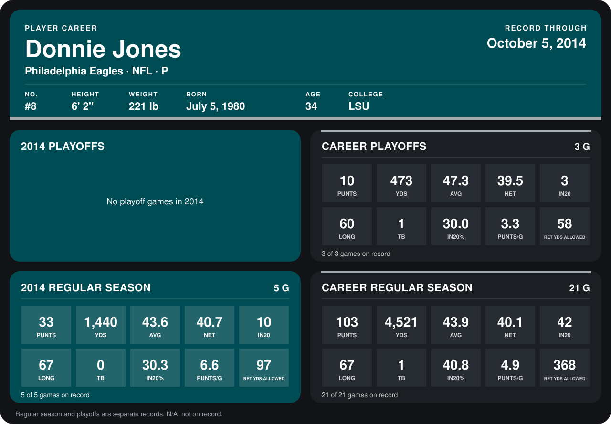

# Donnie Jones

## Career stats

### Regular season

| Season | Club | G | PUNTS | YDS | AVG | NET | IN20 | LONG | TB | IN20% | PUNTS/G | RET YDS ALLOWED |
|---|---|---:|---:|---:|---:|---:|---:|---:|---:|---:|---:|---:|
| 2013 | Philadelphia Eagles | 16 | 70 | 3,081 | 44.0 | 39.9 | 32 | 57 | 1 | 45.7 | 4.4 | 271 |
| 2014 | Philadelphia Eagles | 5 | 33 | 1,440 | 43.6 | 40.7 | 10 | 67 | 0 | 30.3 | 6.6 | 97 |
| **Career** |  | 21 | 103 | 4,521 | 43.9 | 40.1 | 42 | 67 | 1 | 40.8 | 4.9 | 368 |

### Playoffs

| Season | Club | G | PUNTS | YDS | AVG | NET | IN20 | LONG | TB | IN20% | PUNTS/G | RET YDS ALLOWED |
|---|---|---:|---:|---:|---:|---:|---:|---:|---:|---:|---:|---:|
| 2013 | Philadelphia Eagles | 3 | 10 | 473 | 47.3 | 39.5 | 3 | 60 | 1 | 30.0 | 3.3 | 58 |
| **Career** |  | 3 | 10 | 473 | 47.3 | 39.5 | 3 | 60 | 1 | 30.0 | 3.3 | 58 |

## Awards

None on record.

Records through October 5, 2014. Identity: listed 2014 roster data, Weeks 1-4; number: 2014 Week 1 roster. [All Philadelphia Eagles players](README.md).
