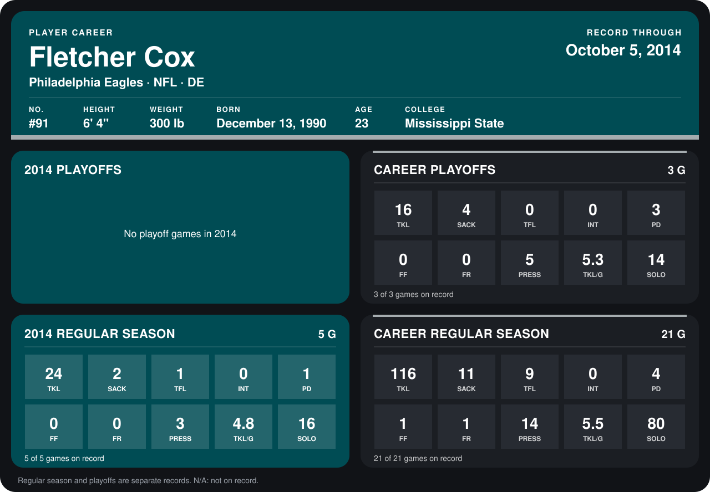

# Fletcher Cox

## Career stats

### Regular season

| Season | Club | G | TKL | SACK | TFL | INT | PD | FF | FR | PRESS | TKL/G | SOLO |
|---|---|---:|---:|---:|---:|---:|---:|---:|---:|---:|---:|---:|
| 2013 | Philadelphia Eagles | 16 | 92 | 9 | 8 | 0 | 3 | 1 | 1 | 11 | 5.8 | 64 |
| 2014 | Philadelphia Eagles | 4 | 18 | 1 | 1 | 0 | 1 | 0 | 0 | 1 | 4.5 | 11 |
| **Career** |  | 20 | 110 | 10 | 9 | 0 | 4 | 1 | 1 | 12 | 5.5 | 75 |

### Playoffs

| Season | Club | G | TKL | SACK | TFL | INT | PD | FF | FR | PRESS | TKL/G | SOLO |
|---|---|---:|---:|---:|---:|---:|---:|---:|---:|---:|---:|---:|
| 2013 | Philadelphia Eagles | 3 | 16 | 4 | 0 | 0 | 3 | 0 | 0 | 5 | 5.3 | 14 |
| **Career** |  | 3 | 16 | 4 | 0 | 0 | 3 | 0 | 0 | 5 | 5.3 | 14 |

## Awards

- AP First-Team All-Pro (2013, DT)
- Pro Bowl selection (2013, DT)

Records through September 29, 2014. Identity: listed 2014 roster data, Weeks 1-4; number: 2014 Week 1 roster. [All Philadelphia Eagles players](README.md).
