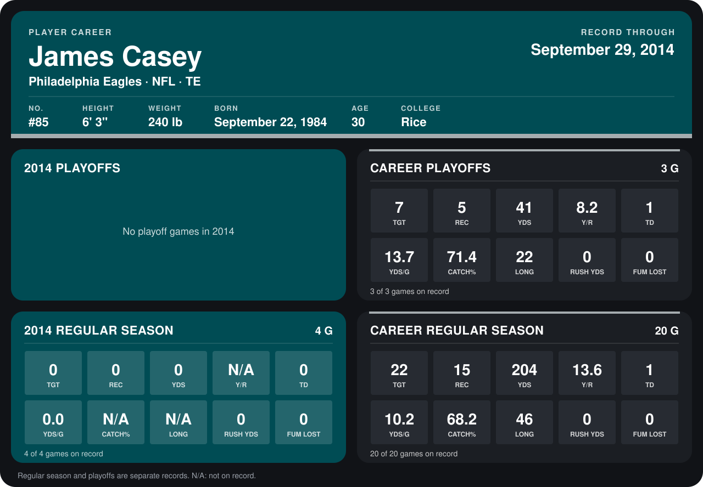

# James Casey

## Career stats

### Regular season

| Season | Club | G | TGT | REC | YDS | Y/R | TD | YDS/G | CATCH% | LONG | RUSH YDS | FUM LOST |
|---|---|---:|---:|---:|---:|---:|---:|---:|---:|---:|---:|---:|
| 2013 | Philadelphia Eagles | 16 | 22 | 15 | 204 | 13.6 | 1 | 12.8 | 68.2 | 46 | 0 | 0 |
| 2014 | Philadelphia Eagles | 5 | 0 | 0 | 0 | N/A | 0 | 0.0 | N/A | N/A | 0 | 0 |
| **Career** |  | 21 | 22 | 15 | 204 | 13.6 | 1 | 9.7 | 68.2 | 46 | 0 | 0 |

### Playoffs

| Season | Club | G | TGT | REC | YDS | Y/R | TD | YDS/G | CATCH% | LONG | RUSH YDS | FUM LOST |
|---|---|---:|---:|---:|---:|---:|---:|---:|---:|---:|---:|---:|
| 2013 | Philadelphia Eagles | 3 | 7 | 5 | 41 | 8.2 | 1 | 13.7 | 71.4 | 22 | 0 | 0 |
| **Career** |  | 3 | 7 | 5 | 41 | 8.2 | 1 | 13.7 | 71.4 | 22 | 0 | 0 |

## Awards

None on record.

Records through October 5, 2014. Identity: listed 2014 roster data, Weeks 1-4; number: 2014 Week 1 roster. [All Philadelphia Eagles players](README.md).
