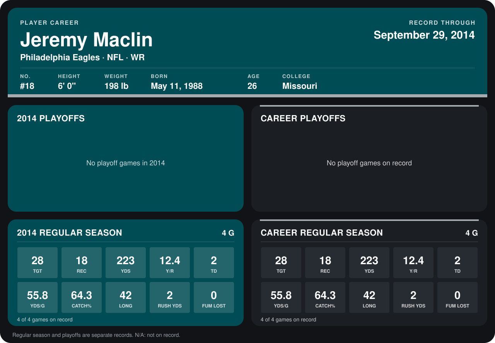

# Jeremy Maclin

## Career stats

### Regular season

| Season | Club | G | TGT | REC | YDS | Y/R | TD | YDS/G | CATCH% | LONG | RUSH YDS | FUM LOST |
|---|---|---:|---:|---:|---:|---:|---:|---:|---:|---:|---:|---:|
| 2014 | Philadelphia Eagles | 4 | 28 | 18 | 223 | 12.4 | 2 | 55.8 | 64.3 | 42 | 2 | 0 |
| **Career** |  | 4 | 28 | 18 | 223 | 12.4 | 2 | 55.8 | 64.3 | 42 | 2 | 0 |

### Playoffs

No playoff games on record.

## Awards

None on record.

Records through September 28, 2014. Identity: listed 2014 roster data, Weeks 1-4; number: 2014 Week 1 roster. [All Philadelphia Eagles players](README.md).
