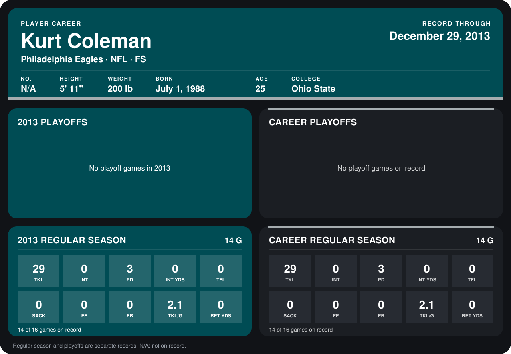

# Kurt Coleman

## Career stats

### Regular season

| Season | Club | G | TKL | INT | PD | INT YDS | TFL | SACK | FF | FR | TKL/G | RET YDS |
|---|---|---:|---:|---:|---:|---:|---:|---:|---:|---:|---:|---:|
| 2013 | Philadelphia Eagles | 14 | 29 | 0 | 3 | 0 | 0 | 0 | 0 | 0 | 2.1 | 0 |
| **Career** |  | 14 | 29 | 0 | 3 | 0 | 0 | 0 | 0 | 0 | 2.1 | 0 |

### Playoffs

No playoff games on record.

## Awards

None on record.

Records through December 29, 2013. Identity: listed 2014 roster data, Weeks 1-4. [All Philadelphia Eagles players](README.md).
