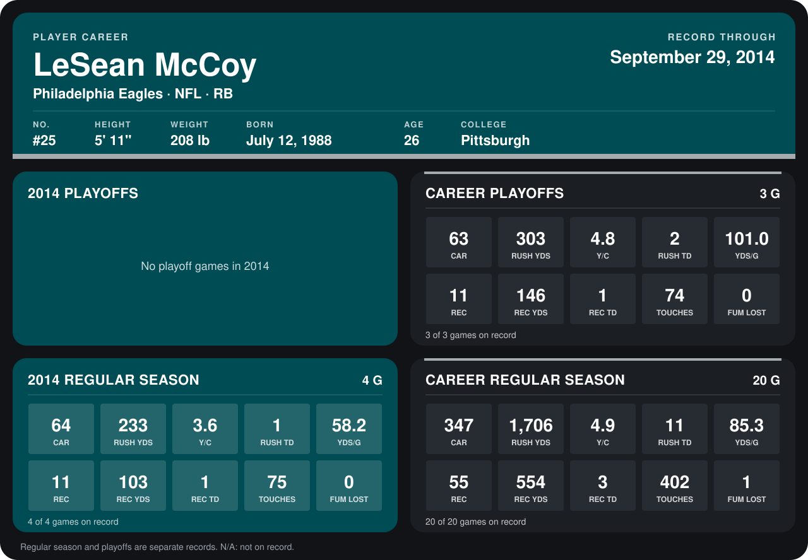

# LeSean McCoy

## Career stats

### Regular season

| Season | Club | G | CAR | RUSH YDS | Y/C | RUSH TD | YDS/G | REC | REC YDS | REC TD | TOUCHES | FUM LOST |
|---|---|---:|---:|---:|---:|---:|---:|---:|---:|---:|---:|---:|
| 2013 | Philadelphia Eagles | 16 | 283 | 1,473 | 5.2 | 10 | 92.1 | 44 | 451 | 2 | 327 | 1 |
| 2014 | Philadelphia Eagles | 4 | 64 | 233 | 3.6 | 1 | 58.2 | 11 | 103 | 1 | 75 | 0 |
| **Career** |  | 20 | 347 | 1,706 | 4.9 | 11 | 85.3 | 55 | 554 | 3 | 402 | 1 |

### Playoffs

| Season | Club | G | CAR | RUSH YDS | Y/C | RUSH TD | YDS/G | REC | REC YDS | REC TD | TOUCHES | FUM LOST |
|---|---|---:|---:|---:|---:|---:|---:|---:|---:|---:|---:|---:|
| 2013 | Philadelphia Eagles | 3 | 63 | 303 | 4.8 | 2 | 101.0 | 11 | 146 | 1 | 74 | 0 |
| **Career** |  | 3 | 63 | 303 | 4.8 | 2 | 101.0 | 11 | 146 | 1 | 74 | 0 |

## Awards

- NFC Offensive Player of the Week (2013, Week 7)

Records through September 28, 2014. Identity: listed 2014 roster data, Weeks 1-4; number: 2014 Week 1 roster. [All Philadelphia Eagles players](README.md).
