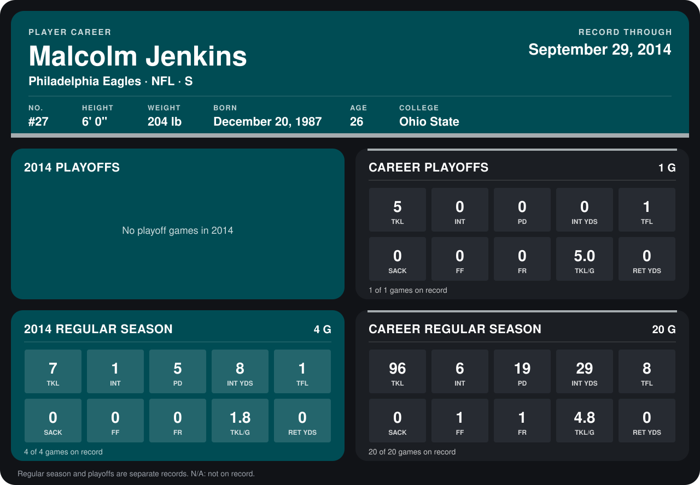

# Malcolm Jenkins

## Career stats

### Regular season

| Season | Club | G | TKL | INT | PD | INT YDS | TFL | SACK | FF | FR | TKL/G | RET YDS |
|---|---|---:|---:|---:|---:|---:|---:|---:|---:|---:|---:|---:|
| 2013 | New Orleans Saints | 16 | 89 | 5 | 14 | 21 | 7 | 0 | 1 | 1 | 5.6 | 0 |
| 2014 | Philadelphia Eagles | 4 | 7 | 1 | 5 | 8 | 1 | 0 | 0 | 0 | 1.8 | 0 |
| **Career** |  | 20 | 96 | 6 | 19 | 29 | 8 | 0 | 1 | 1 | 4.8 | 0 |

### Playoffs

| Season | Club | G | TKL | INT | PD | INT YDS | TFL | SACK | FF | FR | TKL/G | RET YDS |
|---|---|---:|---:|---:|---:|---:|---:|---:|---:|---:|---:|---:|
| 2013 | New Orleans Saints | 1 | 5 | 0 | 0 | 0 | 1 | 0 | 0 | 0 | 5.0 | 0 |
| **Career** |  | 1 | 5 | 0 | 0 | 0 | 1 | 0 | 0 | 0 | 5.0 | 0 |

## Awards

None on record.

Records through September 28, 2014. Identity: listed 2014 roster data, Weeks 1-4; number: 2014 Week 1 roster. [All Philadelphia Eagles players](README.md).
