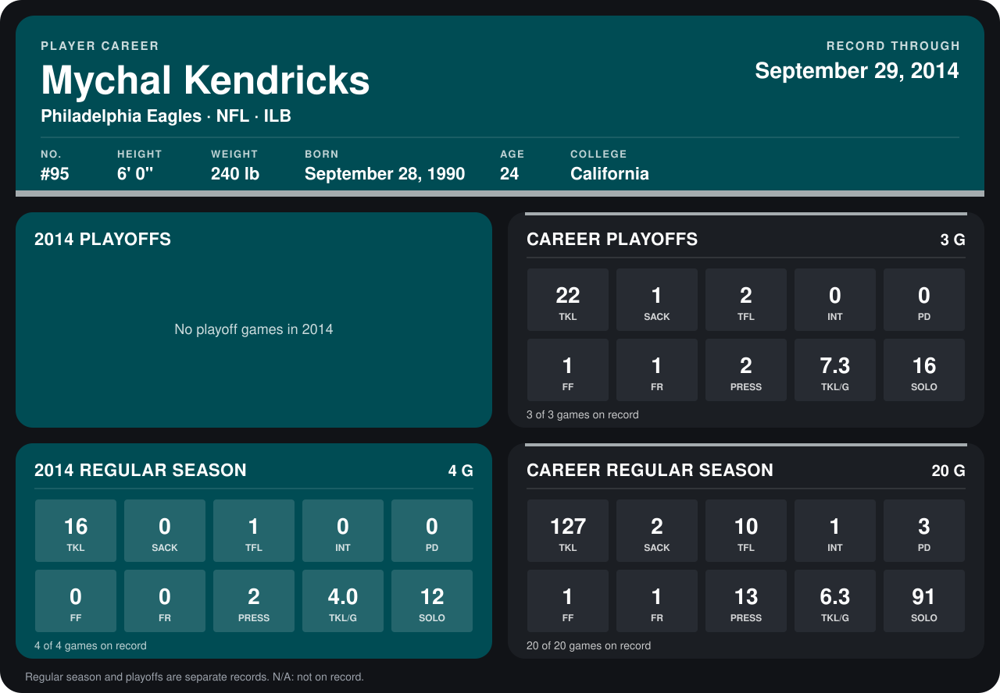

# Mychal Kendricks

## Career stats

### Regular season

| Season | Club | G | TKL | SACK | TFL | INT | PD | FF | FR | PRESS | TKL/G | SOLO |
|---|---|---:|---:|---:|---:|---:|---:|---:|---:|---:|---:|---:|
| 2013 | Philadelphia Eagles | 16 | 111 | 2 | 9 | 1 | 3 | 1 | 1 | 11 | 6.9 | 79 |
| 2014 | Philadelphia Eagles | 4 | 16 | 0 | 1 | 0 | 0 | 0 | 0 | 2 | 4.0 | 12 |
| **Career** |  | 20 | 127 | 2 | 10 | 1 | 3 | 1 | 1 | 13 | 6.3 | 91 |

### Playoffs

| Season | Club | G | TKL | SACK | TFL | INT | PD | FF | FR | PRESS | TKL/G | SOLO |
|---|---|---:|---:|---:|---:|---:|---:|---:|---:|---:|---:|---:|
| 2013 | Philadelphia Eagles | 3 | 22 | 1 | 2 | 0 | 0 | 1 | 1 | 2 | 7.3 | 16 |
| **Career** |  | 3 | 22 | 1 | 2 | 0 | 0 | 1 | 1 | 2 | 7.3 | 16 |

## Awards

None on record.

Records through September 28, 2014. Identity: listed 2014 roster data, Weeks 1-4; number: 2014 Week 1 roster. [All Philadelphia Eagles players](README.md).
