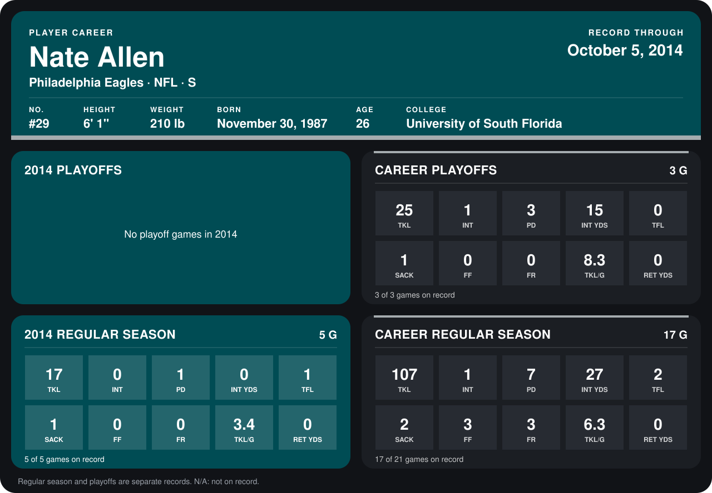

# Nate Allen

## Career stats

### Regular season

| Season | Club | G | TKL | INT | PD | INT YDS | TFL | SACK | FF | FR | TKL/G | RET YDS |
|---|---|---:|---:|---:|---:|---:|---:|---:|---:|---:|---:|---:|
| 2013 | Philadelphia Eagles | 12 | 90 | 1 | 6 | 27 | 1 | 1 | 3 | 3 | 7.5 | 0 |
| 2014 | Philadelphia Eagles | 5 | 17 | 0 | 1 | 0 | 1 | 1 | 0 | 0 | 3.4 | 0 |
| **Career** |  | 17 | 107 | 1 | 7 | 27 | 2 | 2 | 3 | 3 | 6.3 | 0 |

### Playoffs

| Season | Club | G | TKL | INT | PD | INT YDS | TFL | SACK | FF | FR | TKL/G | RET YDS |
|---|---|---:|---:|---:|---:|---:|---:|---:|---:|---:|---:|---:|
| 2013 | Philadelphia Eagles | 3 | 25 | 1 | 3 | 15 | 0 | 1 | 0 | 0 | 8.3 | 0 |
| **Career** |  | 3 | 25 | 1 | 3 | 15 | 0 | 1 | 0 | 0 | 8.3 | 0 |

## Awards

None on record.

Records through October 5, 2014. Identity: listed 2014 roster data, Weeks 1-4; number: 2014 Week 1 roster. [All Philadelphia Eagles players](README.md).
