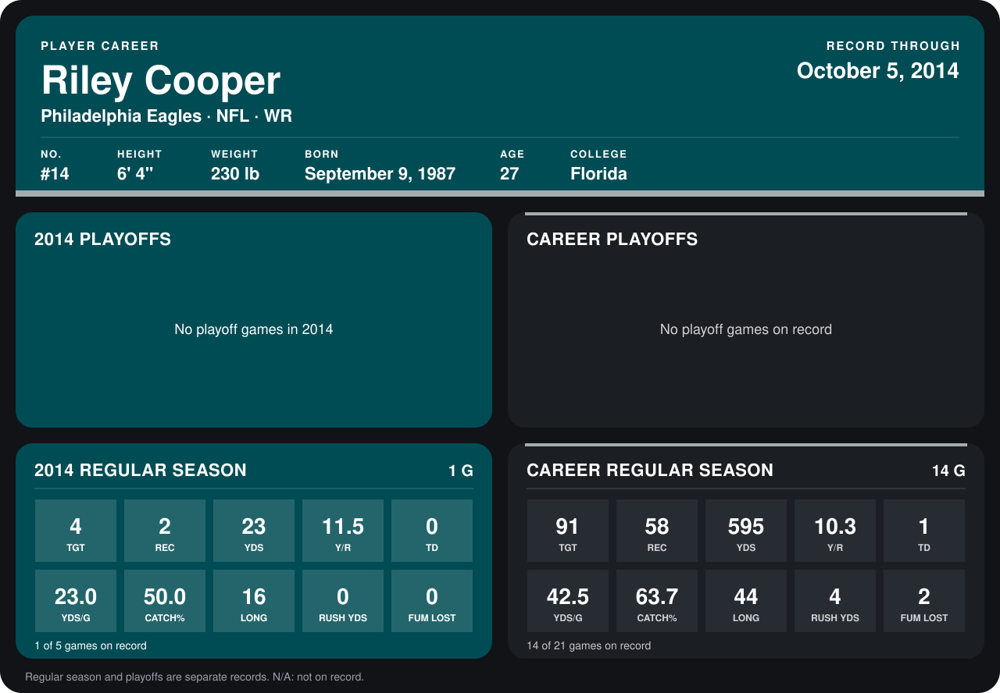

# Riley Cooper

## Career stats

### Regular season

| Season | Team | Age | # | G | TGT | REC | YDS | Y/R | TD | YDS/G | CATCH% | LONG | RUSH YDS | FUM LOST |
|---|---|---:|---:|---:|---:|---:|---:|---:|---:|---:|---:|---:|---:|---:|
| 2013 | Philadelphia Eagles | 25 | 14 | 13 | 87 | 56 | 572 | 10.2 | 1 | 44.0 | 64.4 | 44 | 4 | 2 |
| 2014 | Philadelphia Eagles | 26 | 14 | 1 | 4 | 2 | 23 | 11.5 | 0 | 23.0 | 50.0 | 16 | 0 | 0 |
| **Career** |  |  |  | 14 | 91 | 58 | 595 | 10.3 | 1 | 42.5 | 63.7 | 44 | 4 | 2 |

### Playoffs

No playoff games on record.

## Awards

None on record.

Age is his age on the league's opening game of each season; # is the number listed for him that season with that team (2014: the card's rule; 2013: the 2013 season roster), N/A where no listing applies.

Records through September 28, 2014. Identity: listed 2014 roster data, Weeks 1-4; number: 2014 Week 1 roster. [All Philadelphia Eagles players](README.md).
