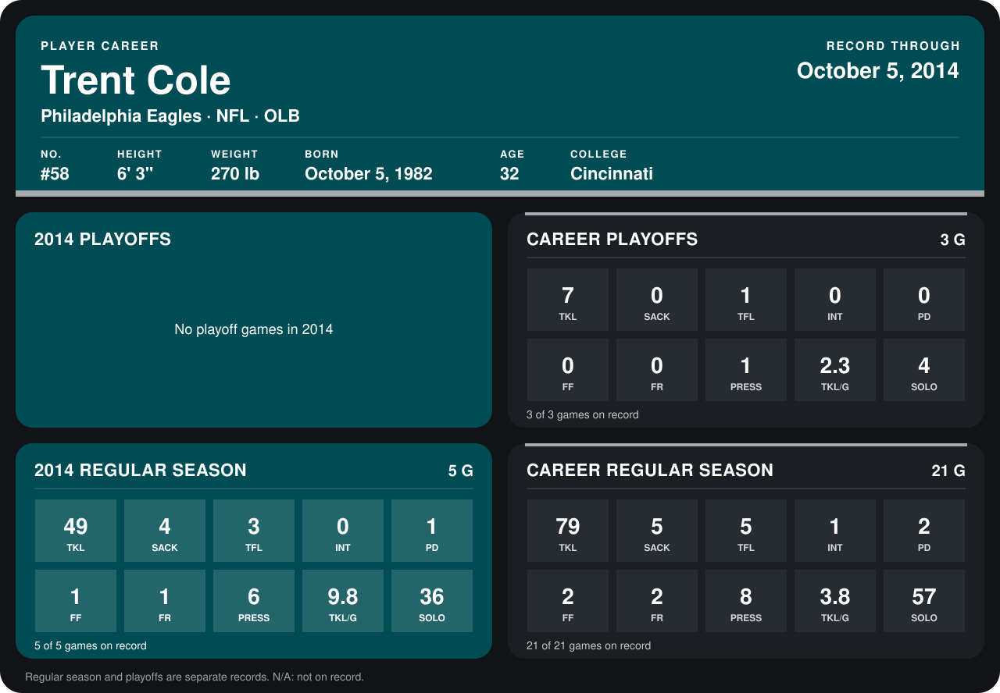

# Trent Cole

## Career stats

### Regular season

| Season | Club | G | TKL | SACK | TFL | INT | PD | FF | FR | PRESS | TKL/G | SOLO |
|---|---|---:|---:|---:|---:|---:|---:|---:|---:|---:|---:|---:|
| 2013 | Philadelphia Eagles | 16 | 30 | 1 | 2 | 1 | 1 | 1 | 1 | 2 | 1.9 | 21 |
| 2014 | Philadelphia Eagles | 4 | 42 | 3 | 2 | 0 | 0 | 1 | 1 | 5 | 10.5 | 32 |
| **Career** |  | 20 | 72 | 4 | 4 | 1 | 1 | 2 | 2 | 7 | 3.6 | 53 |

### Playoffs

| Season | Club | G | TKL | SACK | TFL | INT | PD | FF | FR | PRESS | TKL/G | SOLO |
|---|---|---:|---:|---:|---:|---:|---:|---:|---:|---:|---:|---:|
| 2013 | Philadelphia Eagles | 3 | 7 | 0 | 1 | 0 | 0 | 0 | 0 | 1 | 2.3 | 4 |
| **Career** |  | 3 | 7 | 0 | 1 | 0 | 0 | 0 | 0 | 1 | 2.3 | 4 |

## Awards

- NFC Defensive Player of the Week (2014, Week 1)

Records through September 29, 2014. Identity: listed 2014 roster data, Weeks 1-4; number: 2014 Week 1 roster. [All Philadelphia Eagles players](README.md).
