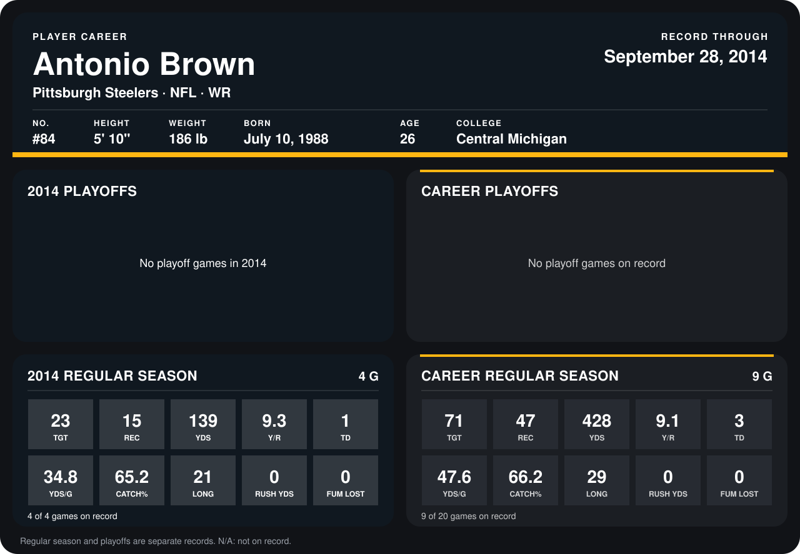

# Antonio Brown

## Career stats

### Regular season

| Season | Club | G | TGT | REC | YDS | Y/R | TD | YDS/G | CATCH% | LONG | RUSH YDS | FUM LOST |
|---|---|---:|---:|---:|---:|---:|---:|---:|---:|---:|---:|---:|
| 2013 | Pittsburgh Steelers | 5 | 48 | 32 | 289 | 9.0 | 2 | 57.8 | 66.7 | 29 | 0 | 0 |
| 2014 | Pittsburgh Steelers | 5 | 29 | 19 | 161 | 8.5 | 1 | 32.2 | 65.5 | 21 | 0 | 0 |
| **Career** |  | 10 | 77 | 51 | 450 | 8.8 | 3 | 45.0 | 66.2 | 29 | 0 | 0 |

### Playoffs

No playoff games on record.

## Awards

None on record.

Records through October 5, 2014. Identity: listed 2014 roster data, Weeks 1-4; number: 2014 Week 1 roster. [All Pittsburgh Steelers players](README.md).
