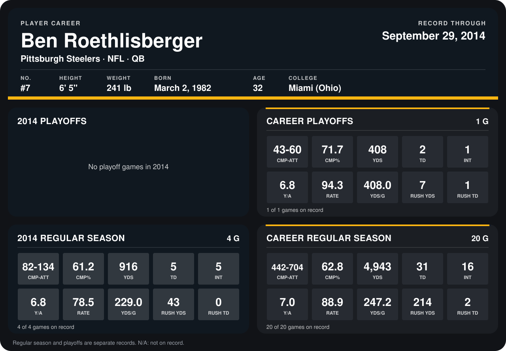

# Ben Roethlisberger

## Career stats

### Regular season

| Season | Team | Age | # | G | CMP-ATT | CMP% | YDS | TD | INT | Y/A | RATE | YDS/G | RUSH YDS | RUSH TD |
|---|---|---:|---:|---:|---:|---:|---:|---:|---:|---:|---:|---:|---:|---:|
| 2013 | Pittsburgh Steelers | 31 | 7 | 16 | 360-570 | 63.2 | 4,027 | 26 | 11 | 7.1 | 91.3 | 251.7 | 171 | 2 |
| 2014 | Pittsburgh Steelers | 32 | 7 | 5 | 99-161 | 61.5 | 1,107 | 6 | 5 | 6.9 | 81.5 | 221.4 | 52 | 1 |
| **Career** |  |  |  | 21 | 459-731 | 62.8 | 5,134 | 32 | 16 | 7.0 | 89.1 | 244.5 | 223 | 3 |

### Playoffs

| Season | Team | Age | # | G | CMP-ATT | CMP% | YDS | TD | INT | Y/A | RATE | YDS/G | RUSH YDS | RUSH TD |
|---|---|---:|---:|---:|---:|---:|---:|---:|---:|---:|---:|---:|---:|---:|
| 2013 | Pittsburgh Steelers | 31 | 7 | 1 | 43-60 | 71.7 | 408 | 2 | 1 | 6.8 | 94.3 | 408.0 | 7 | 1 |
| **Career** |  |  |  | 1 | 43-60 | 71.7 | 408 | 2 | 1 | 6.8 | 94.3 | 408.0 | 7 | 1 |

## Awards

None on record.

Age is his age on the league's opening game of each season; # is the number listed for him that season with that team (2014: the card's rule; 2013: the 2013 season roster), N/A where no listing applies.

Records through October 5, 2014. Identity: listed 2014 roster data, Weeks 1-4; number: 2014 Week 1 roster. [All Pittsburgh Steelers players](README.md).
