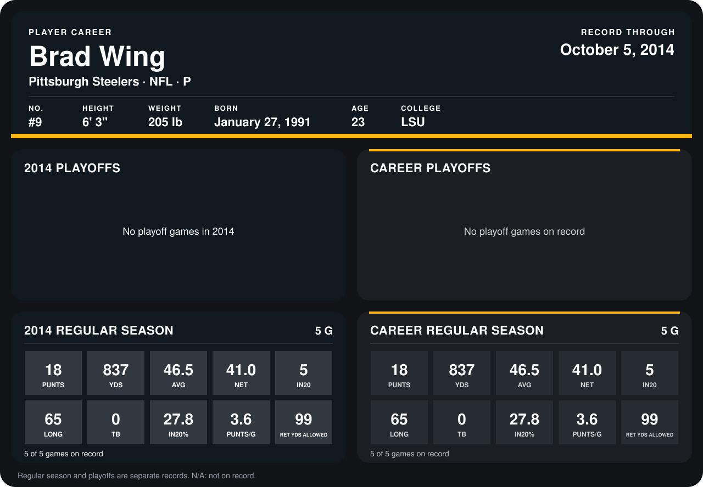

# Brad Wing

## Career stats

### Regular season

| Season | Club | G | PUNTS | YDS | AVG | NET | IN20 | LONG | TB | IN20% | PUNTS/G | RET YDS ALLOWED |
|---|---|---:|---:|---:|---:|---:|---:|---:|---:|---:|---:|---:|
| 2014 | Pittsburgh Steelers | 4 | 13 | 615 | 47.3 | 41.5 | 5 | 65 | 0 | 38.5 | 3.2 | 76 |
| **Career** |  | 4 | 13 | 615 | 47.3 | 41.5 | 5 | 65 | 0 | 38.5 | 3.2 | 76 |

### Playoffs

No playoff games on record.

## Awards

None on record.

Records through September 29, 2014. Identity: listed 2014 roster data, Weeks 1-4; number: 2014 Week 1 roster. [All Pittsburgh Steelers players](README.md).
