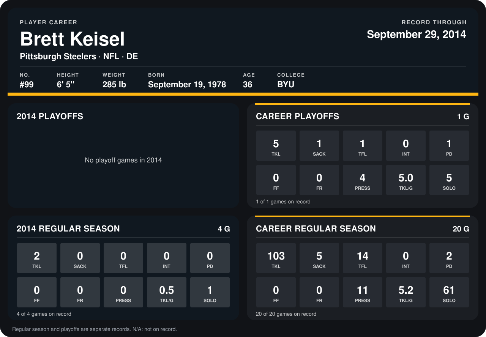

# Brett Keisel

## Career stats

### Regular season

| Season | Club | G | TKL | SACK | TFL | INT | PD | FF | FR | PRESS | TKL/G | SOLO |
|---|---|---:|---:|---:|---:|---:|---:|---:|---:|---:|---:|---:|
| 2013 | Pittsburgh Steelers | 16 | 101 | 5 | 14 | 0 | 2 | 0 | 0 | 11 | 6.3 | 60 |
| 2014 | Pittsburgh Steelers | 5 | 2 | 0 | 0 | 0 | 0 | 0 | 0 | 0 | 0.4 | 1 |
| **Career** |  | 21 | 103 | 5 | 14 | 0 | 2 | 0 | 0 | 11 | 4.9 | 61 |

### Playoffs

| Season | Club | G | TKL | SACK | TFL | INT | PD | FF | FR | PRESS | TKL/G | SOLO |
|---|---|---:|---:|---:|---:|---:|---:|---:|---:|---:|---:|---:|
| 2013 | Pittsburgh Steelers | 1 | 5 | 1 | 1 | 0 | 1 | 0 | 0 | 4 | 5.0 | 5 |
| **Career** |  | 1 | 5 | 1 | 1 | 0 | 1 | 0 | 0 | 4 | 5.0 | 5 |

## Awards

None on record.

Records through October 5, 2014. Identity: listed 2014 roster data, Weeks 1-4; number: 2014 Week 1 roster. [All Pittsburgh Steelers players](README.md).
