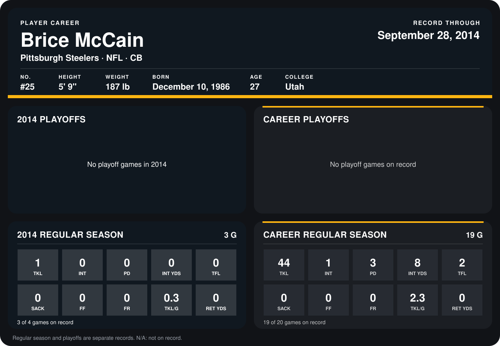

# Brice McCain

## Career stats

### Regular season

| Season | Team | Age | # | G | TKL | INT | PD | INT YDS | TFL | SACK | FF | FR | TKL/G | RET YDS |
|---|---|---:|---:|---:|---:|---:|---:|---:|---:|---:|---:|---:|---:|---:|
| 2013 | Houston Texans | 26 | 21 | 16 | 43 | 1 | 3 | 8 | 2 | 0 | 0 | 0 | 2.7 | 0 |
| 2014 | Pittsburgh Steelers | 27 | 25 | 3 | 1 | 0 | 0 | 0 | 0 | 0 | 0 | 0 | 0.3 | 0 |
| **Career** |  |  |  | 19 | 44 | 1 | 3 | 8 | 2 | 0 | 0 | 0 | 2.3 | 0 |

### Playoffs

No playoff games on record.

## Awards

None on record.

Age is his age on the league's opening game of each season; # is the number listed for him that season with that team (2014: the card's rule; 2013: the 2013 season roster), N/A where no listing applies.

Records through September 28, 2014. Identity: listed 2014 roster data, Weeks 1-4; number: 2014 Week 1 roster. [All Pittsburgh Steelers players](README.md).
