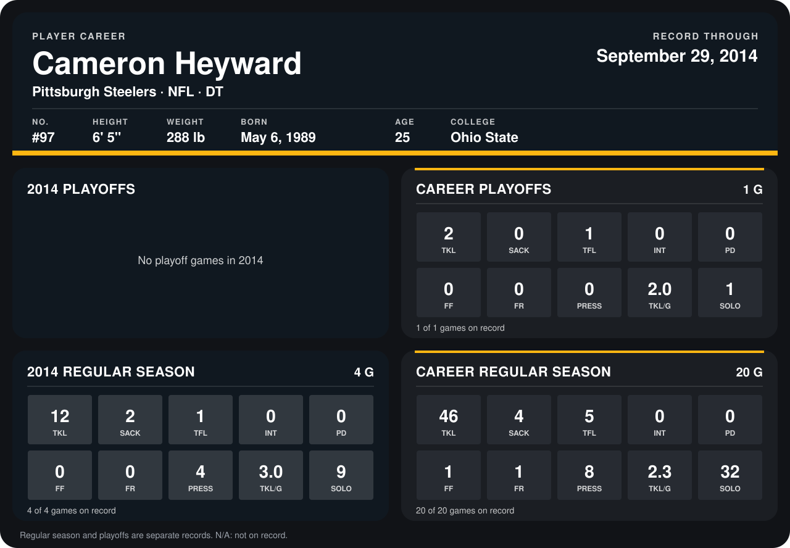

# Cameron Heyward

## Career stats

### Regular season

| Season | Club | G | TKL | SACK | TFL | INT | PD | FF | FR | PRESS | TKL/G | SOLO |
|---|---|---:|---:|---:|---:|---:|---:|---:|---:|---:|---:|---:|
| 2013 | Pittsburgh Steelers | 16 | 34 | 2 | 4 | 0 | 0 | 1 | 1 | 4 | 2.1 | 23 |
| 2014 | Pittsburgh Steelers | 4 | 12 | 2 | 1 | 0 | 0 | 0 | 0 | 4 | 3.0 | 9 |
| **Career** |  | 20 | 46 | 4 | 5 | 0 | 0 | 1 | 1 | 8 | 2.3 | 32 |

### Playoffs

| Season | Club | G | TKL | SACK | TFL | INT | PD | FF | FR | PRESS | TKL/G | SOLO |
|---|---|---:|---:|---:|---:|---:|---:|---:|---:|---:|---:|---:|
| 2013 | Pittsburgh Steelers | 1 | 2 | 0 | 1 | 0 | 0 | 0 | 0 | 0 | 2.0 | 1 |
| **Career** |  | 1 | 2 | 0 | 1 | 0 | 0 | 0 | 0 | 0 | 2.0 | 1 |

## Awards

None on record.

Records through September 29, 2014. Identity: listed 2014 roster data, Weeks 1-4; number: 2014 Week 1 roster. [All Pittsburgh Steelers players](README.md).
