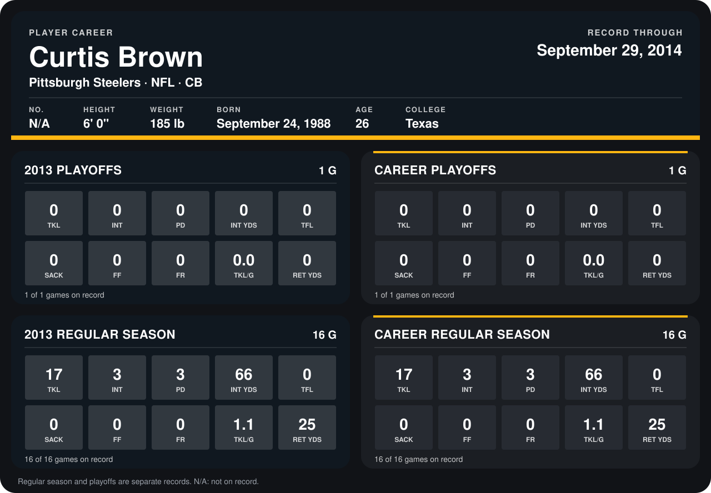

# Curtis Brown

## Career stats

### Regular season

| Season | Club | G | TKL | INT | PD | INT YDS | TFL | SACK | FF | FR | TKL/G | RET YDS |
|---|---|---:|---:|---:|---:|---:|---:|---:|---:|---:|---:|---:|
| 2013 | Pittsburgh Steelers | 16 | 17 | 3 | 3 | 66 | 0 | 0 | 0 | 0 | 1.1 | 25 |
| **Career** |  | 16 | 17 | 3 | 3 | 66 | 0 | 0 | 0 | 0 | 1.1 | 25 |

### Playoffs

| Season | Club | G | TKL | INT | PD | INT YDS | TFL | SACK | FF | FR | TKL/G | RET YDS |
|---|---|---:|---:|---:|---:|---:|---:|---:|---:|---:|---:|---:|
| 2013 | Pittsburgh Steelers | 1 | 0 | 0 | 0 | 0 | 0 | 0 | 0 | 0 | 0.0 | 0 |
| **Career** |  | 1 | 0 | 0 | 0 | 0 | 0 | 0 | 0 | 0 | 0.0 | 0 |

## Awards

None on record.

Records through January 5, 2014. Identity: his listed 2013 season roster data (no 2014 Weeks 1-4 roster row). [All Pittsburgh Steelers players](README.md).
