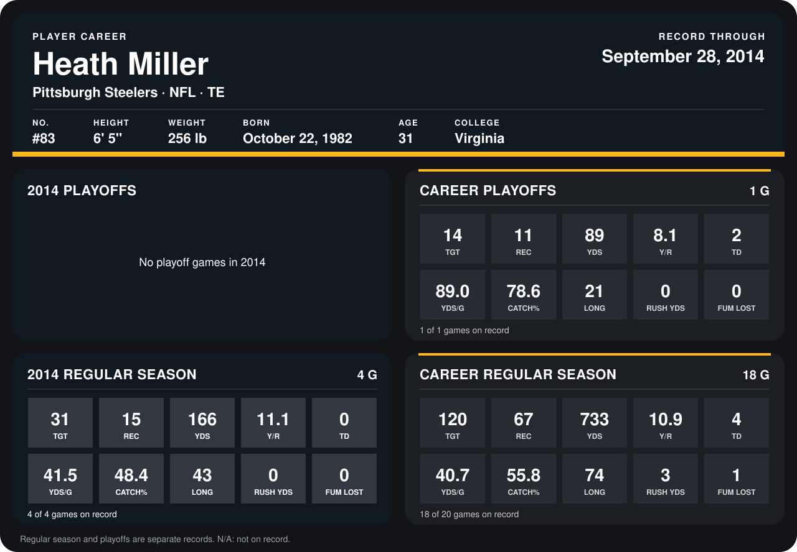

# Heath Miller

## Career stats

### Regular season

| Season | Club | G | TGT | REC | YDS | Y/R | TD | YDS/G | CATCH% | LONG | RUSH YDS | FUM LOST |
|---|---|---:|---:|---:|---:|---:|---:|---:|---:|---:|---:|---:|
| 2013 | Pittsburgh Steelers | 14 | 89 | 52 | 567 | 10.9 | 4 | 40.5 | 58.4 | 74 | 3 | 1 |
| 2014 | Pittsburgh Steelers | 4 | 31 | 15 | 166 | 11.1 | 0 | 41.5 | 48.4 | 43 | 0 | 0 |
| **Career** |  | 18 | 120 | 67 | 733 | 10.9 | 4 | 40.7 | 55.8 | 74 | 3 | 1 |

### Playoffs

| Season | Club | G | TGT | REC | YDS | Y/R | TD | YDS/G | CATCH% | LONG | RUSH YDS | FUM LOST |
|---|---|---:|---:|---:|---:|---:|---:|---:|---:|---:|---:|---:|
| 2013 | Pittsburgh Steelers | 1 | 14 | 11 | 89 | 8.1 | 2 | 89.0 | 78.6 | 21 | 0 | 0 |
| **Career** |  | 1 | 14 | 11 | 89 | 8.1 | 2 | 89.0 | 78.6 | 21 | 0 | 0 |

## Awards

None on record.

Records through September 28, 2014. Identity: listed 2014 roster data, Weeks 1-4; number: 2014 Week 1 roster. [All Pittsburgh Steelers players](README.md).
