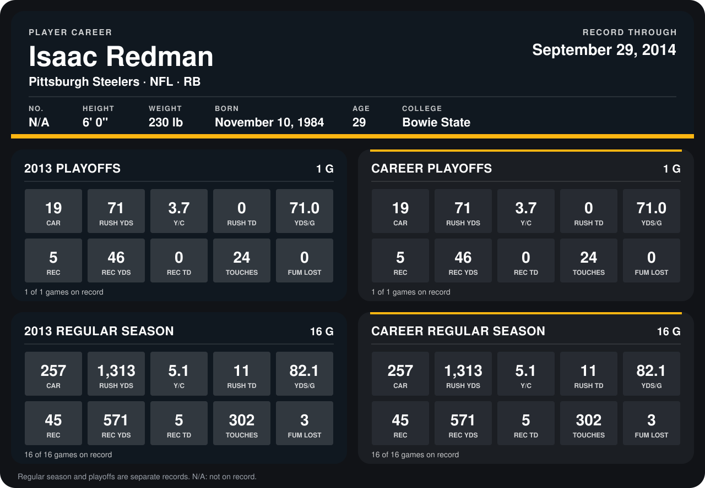

# Isaac Redman

## Career stats

### Regular season

| Season | Team | Age | # | G | CAR | RUSH YDS | Y/C | RUSH TD | YDS/G | REC | REC YDS | REC TD | TOUCHES | FUM LOST |
|---|---|---:|---:|---:|---:|---:|---:|---:|---:|---:|---:|---:|---:|---:|
| 2013 | Pittsburgh Steelers | 28 | 33 | 16 | 257 | 1,313 | 5.1 | 11 | 82.1 | 45 | 571 | 5 | 302 | 3 |
| **Career** |  |  |  | 16 | 257 | 1,313 | 5.1 | 11 | 82.1 | 45 | 571 | 5 | 302 | 3 |

### Playoffs

| Season | Team | Age | # | G | CAR | RUSH YDS | Y/C | RUSH TD | YDS/G | REC | REC YDS | REC TD | TOUCHES | FUM LOST |
|---|---|---:|---:|---:|---:|---:|---:|---:|---:|---:|---:|---:|---:|---:|
| 2013 | Pittsburgh Steelers | 28 | 33 | 1 | 19 | 71 | 3.7 | 0 | 71.0 | 5 | 46 | 0 | 24 | 0 |
| **Career** |  |  |  | 1 | 19 | 71 | 3.7 | 0 | 71.0 | 5 | 46 | 0 | 24 | 0 |

## Awards

- AFC Offensive Player of the Week (2013, Week 2)

Age is his age on the league's opening game of each season; # is the number listed for him that season with that team (2014: the card's rule; 2013: the 2013 season roster), N/A where no listing applies.

Records through January 5, 2014. Identity: his listed 2013 season roster data (no 2014 Weeks 1-4 roster row). [All Pittsburgh Steelers players](README.md).
