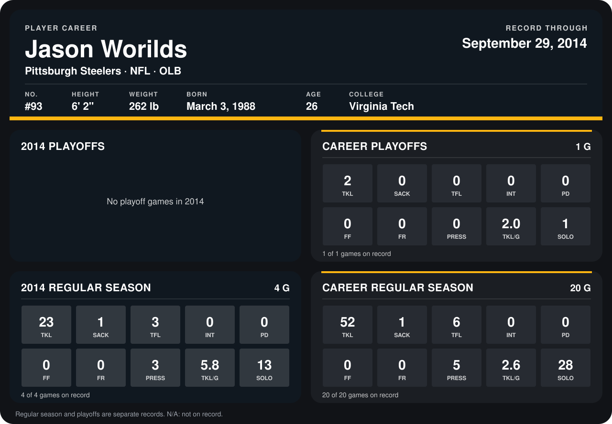

# Jason Worilds

## Career stats

### Regular season

| Season | Club | G | TKL | SACK | TFL | INT | PD | FF | FR | PRESS | TKL/G | SOLO |
|---|---|---:|---:|---:|---:|---:|---:|---:|---:|---:|---:|---:|
| 2013 | Pittsburgh Steelers | 16 | 29 | 0 | 3 | 0 | 0 | 0 | 0 | 2 | 1.8 | 15 |
| 2014 | Pittsburgh Steelers | 5 | 28 | 1 | 3 | 0 | 0 | 0 | 0 | 3 | 5.6 | 17 |
| **Career** |  | 21 | 57 | 1 | 6 | 0 | 0 | 0 | 0 | 5 | 2.7 | 32 |

### Playoffs

| Season | Club | G | TKL | SACK | TFL | INT | PD | FF | FR | PRESS | TKL/G | SOLO |
|---|---|---:|---:|---:|---:|---:|---:|---:|---:|---:|---:|---:|
| 2013 | Pittsburgh Steelers | 1 | 2 | 0 | 0 | 0 | 0 | 0 | 0 | 0 | 2.0 | 1 |
| **Career** |  | 1 | 2 | 0 | 0 | 0 | 0 | 0 | 0 | 0 | 2.0 | 1 |

## Awards

None on record.

Records through October 5, 2014. Identity: listed 2014 roster data, Weeks 1-4; number: 2014 Week 1 roster. [All Pittsburgh Steelers players](README.md).
