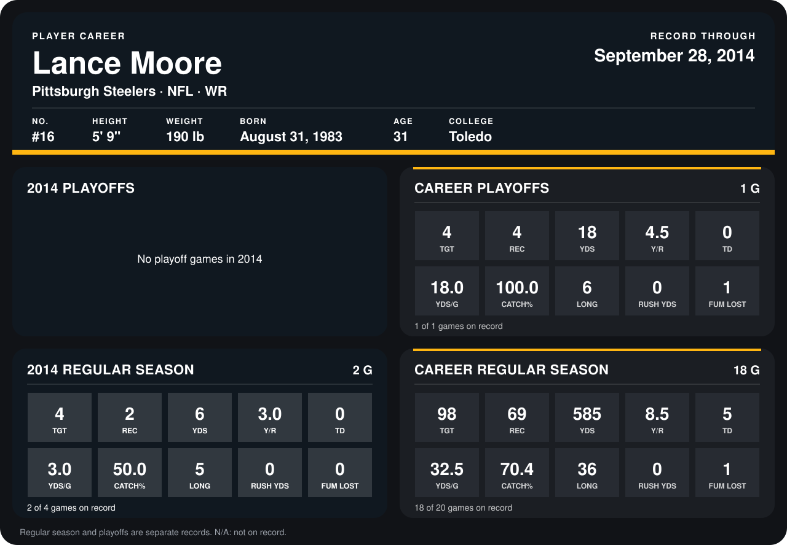

# Lance Moore

## Career stats

### Regular season

| Season | Club | G | TGT | REC | YDS | Y/R | TD | YDS/G | CATCH% | LONG | RUSH YDS | FUM LOST |
|---|---|---:|---:|---:|---:|---:|---:|---:|---:|---:|---:|---:|
| 2013 | New Orleans Saints | 16 | 94 | 67 | 579 | 8.6 | 5 | 36.2 | 71.3 | 36 | 0 | 1 |
| 2014 | Pittsburgh Steelers | 2 | 4 | 2 | 6 | 3.0 | 0 | 3.0 | 50.0 | 5 | 0 | 0 |
| **Career** |  | 18 | 98 | 69 | 585 | 8.5 | 5 | 32.5 | 70.4 | 36 | 0 | 1 |

### Playoffs

| Season | Club | G | TGT | REC | YDS | Y/R | TD | YDS/G | CATCH% | LONG | RUSH YDS | FUM LOST |
|---|---|---:|---:|---:|---:|---:|---:|---:|---:|---:|---:|---:|
| 2013 | New Orleans Saints | 1 | 4 | 4 | 18 | 4.5 | 0 | 18.0 | 100.0 | 6 | 0 | 1 |
| **Career** |  | 1 | 4 | 4 | 18 | 4.5 | 0 | 18.0 | 100.0 | 6 | 0 | 1 |

## Awards

None on record.

Records through September 29, 2014. Identity: listed 2014 roster data, Weeks 1-4; number: 2014 Week 1 roster. [All Pittsburgh Steelers players](README.md).
