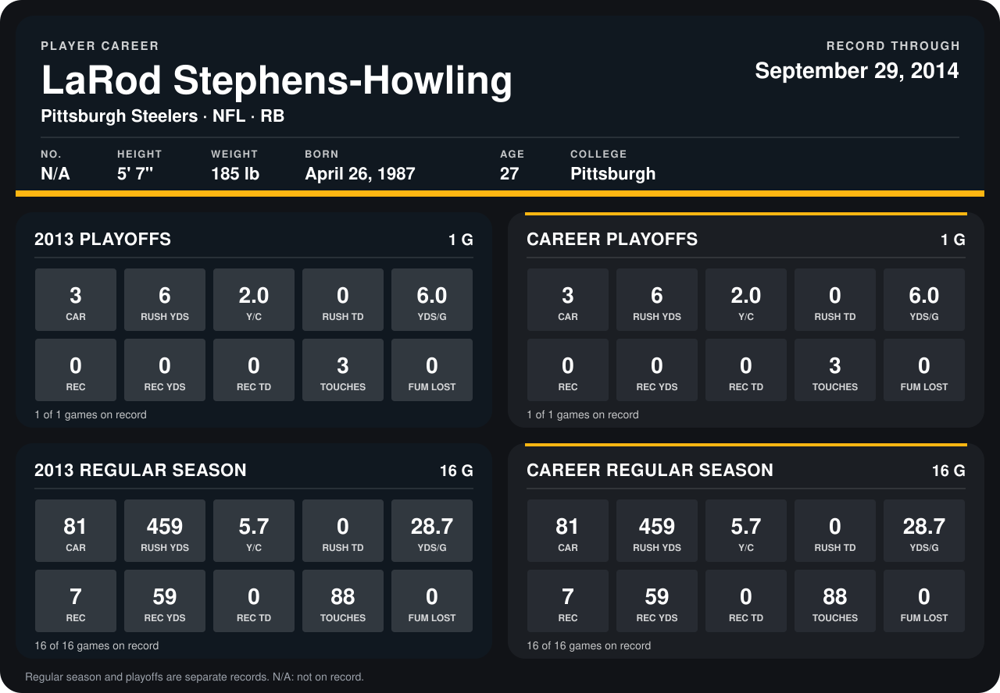

# LaRod Stephens-Howling

## Career stats

### Regular season

| Season | Club | G | CAR | RUSH YDS | Y/C | RUSH TD | YDS/G | REC | REC YDS | REC TD | TOUCHES | FUM LOST |
|---|---|---:|---:|---:|---:|---:|---:|---:|---:|---:|---:|---:|
| 2013 | Pittsburgh Steelers | 16 | 81 | 459 | 5.7 | 0 | 28.7 | 7 | 59 | 0 | 88 | 0 |
| **Career** |  | 16 | 81 | 459 | 5.7 | 0 | 28.7 | 7 | 59 | 0 | 88 | 0 |

### Playoffs

| Season | Club | G | CAR | RUSH YDS | Y/C | RUSH TD | YDS/G | REC | REC YDS | REC TD | TOUCHES | FUM LOST |
|---|---|---:|---:|---:|---:|---:|---:|---:|---:|---:|---:|---:|
| 2013 | Pittsburgh Steelers | 1 | 3 | 6 | 2.0 | 0 | 6.0 | 0 | 0 | 0 | 3 | 0 |
| **Career** |  | 1 | 3 | 6 | 2.0 | 0 | 6.0 | 0 | 0 | 0 | 3 | 0 |

## Awards

None on record.

Records through January 5, 2014. Identity: his listed 2013 season roster data (no 2014 Weeks 1-4 roster row). [All Pittsburgh Steelers players](README.md).
