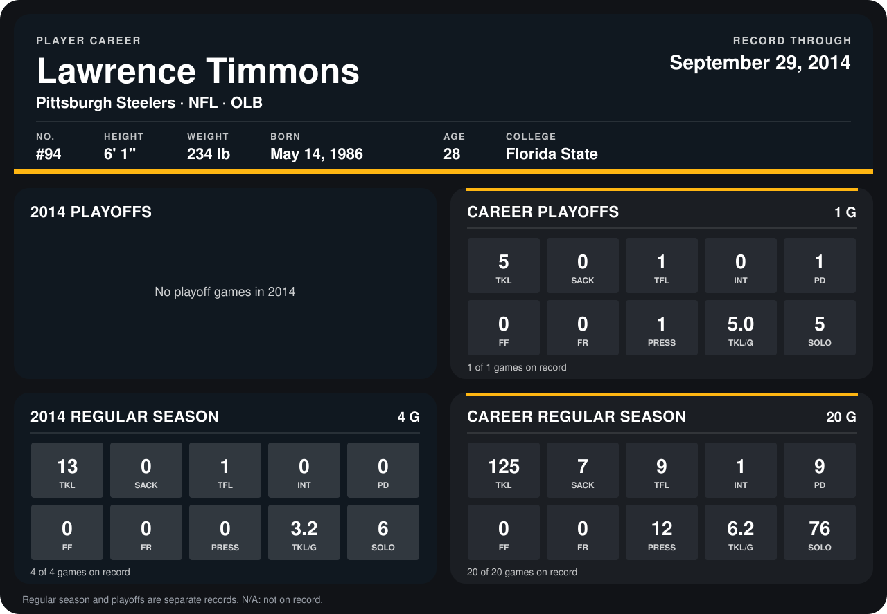

# Lawrence Timmons

## Career stats

### Regular season

| Season | Club | G | TKL | SACK | TFL | INT | PD | FF | FR | PRESS | TKL/G | SOLO |
|---|---|---:|---:|---:|---:|---:|---:|---:|---:|---:|---:|---:|
| 2013 | Pittsburgh Steelers | 16 | 112 | 7 | 8 | 1 | 9 | 0 | 0 | 12 | 7.0 | 70 |
| 2014 | Pittsburgh Steelers | 4 | 13 | 0 | 1 | 0 | 0 | 0 | 0 | 0 | 3.2 | 6 |
| **Career** |  | 20 | 125 | 7 | 9 | 1 | 9 | 0 | 0 | 12 | 6.2 | 76 |

### Playoffs

| Season | Club | G | TKL | SACK | TFL | INT | PD | FF | FR | PRESS | TKL/G | SOLO |
|---|---|---:|---:|---:|---:|---:|---:|---:|---:|---:|---:|---:|
| 2013 | Pittsburgh Steelers | 1 | 5 | 0 | 1 | 0 | 1 | 0 | 0 | 1 | 5.0 | 5 |
| **Career** |  | 1 | 5 | 0 | 1 | 0 | 1 | 0 | 0 | 1 | 5.0 | 5 |

## Awards

None on record.

Records through September 28, 2014. Identity: listed 2014 roster data, Weeks 1-4; number: 2014 Week 1 roster. [All Pittsburgh Steelers players](README.md).
