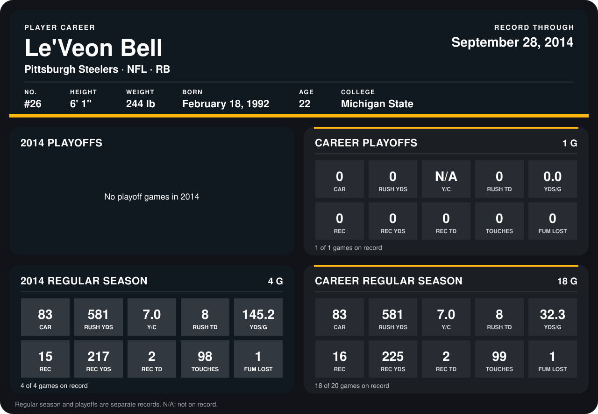

# Le'Veon Bell

## Career stats

### Regular season

| Season | Club | G | CAR | RUSH YDS | Y/C | RUSH TD | YDS/G | REC | REC YDS | REC TD | TOUCHES | FUM LOST |
|---|---|---:|---:|---:|---:|---:|---:|---:|---:|---:|---:|---:|
| 2013 | Pittsburgh Steelers | 14 | 0 | 0 | N/A | 0 | 0.0 | 1 | 8 | 0 | 1 | 0 |
| 2014 | Pittsburgh Steelers | 4 | 83 | 581 | 7.0 | 8 | 145.2 | 15 | 217 | 2 | 98 | 1 |
| **Career** |  | 18 | 83 | 581 | 7.0 | 8 | 32.3 | 16 | 225 | 2 | 99 | 1 |

### Playoffs

| Season | Club | G | CAR | RUSH YDS | Y/C | RUSH TD | YDS/G | REC | REC YDS | REC TD | TOUCHES | FUM LOST |
|---|---|---:|---:|---:|---:|---:|---:|---:|---:|---:|---:|---:|
| 2013 | Pittsburgh Steelers | 1 | 0 | 0 | N/A | 0 | 0.0 | 0 | 0 | 0 | 0 | 0 |
| **Career** |  | 1 | 0 | 0 | N/A | 0 | 0.0 | 0 | 0 | 0 | 0 | 0 |

## Awards

- AFC Offensive Player of the Week (2014, Week 2)
- AFC Offensive Player of the Week (2014, Week 3)

Records through September 28, 2014. Identity: listed 2014 roster data, Weeks 1-4; number: 2014 Week 1 roster. [All Pittsburgh Steelers players](README.md).
